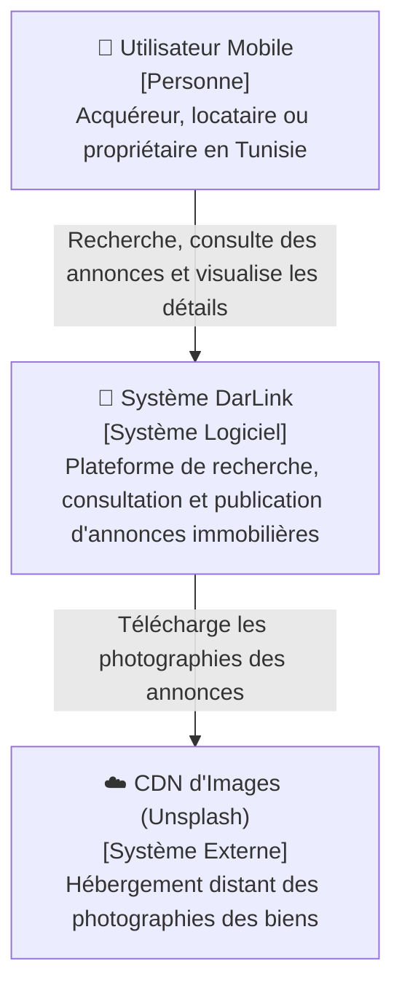

# C4 NIVEAU 1 — DIAGRAMME DE CONTEXTE SYSTÈME (SYSTEM CONTEXT)

Le diagramme de contexte présente la place du système **DarLink** par rapport à ses utilisateurs et aux systèmes externes, sans entrer dans les détails d'implémentation.

---

## 1. DIAGRAMME MERMAID DU CONTEXTE SYSTÈME

---

## 2. DESCRIPTION DES ÉLÉMENTS

| Élément | Type C4 | Description & Rôle |
|---|---|---|
| **Utilisateur Mobile** | Personne | Tout utilisateur tunisien cherchant à acheter, louer ou proposer un logement. |
| **Système DarLink** | Système Logiciel | La solution logicielle complète faisant l'objet du mini-projet universitaire. |
| **CDN d'Images (Unsplash)** | Système Externe | Fournisseur tiers hébergeant les photographies de démonstration accessibles par URL HTTPS. |

---

## 3. ÉVOLUTION DU CONTEXTE VERS LES VERSIONS SUIVANTES
Dans les versions ultérieures (V8 à V10), d'autres systèmes externes viendront enrichir ce diagramme :
- Service de tuiles cartographiques (OpenStreetMap / Leaflet ou Google Maps).
- Passerelle de notifications push (Firebase Cloud Messaging / Expo Push).

