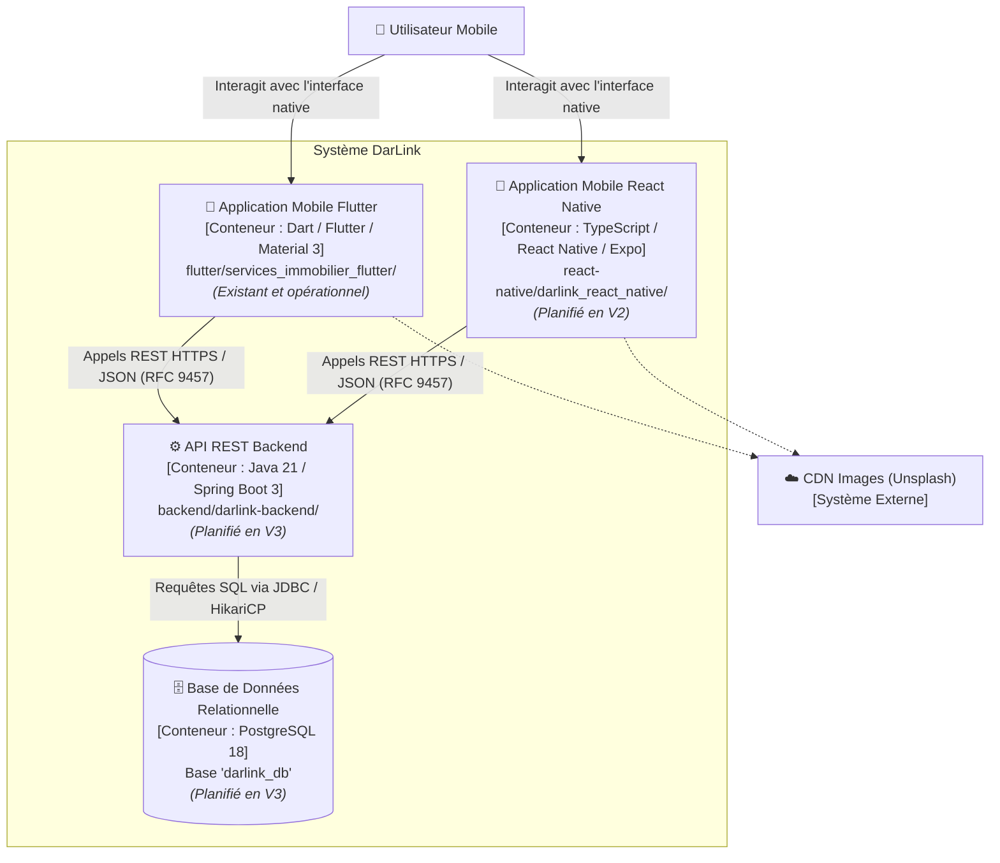

# C4 NIVEAU 2 — DIAGRAMME DES CONTENEURS (CONTAINER DIAGRAM)

Un conteneur au sens C4 représente une unité logicielle exécutable de manière autonome (application mobile, serveur web, base de données).

---

## 1. DIAGRAMME C4 DES CONTENEURS (CIBLE MVP P1)

---

## 2. INVENTAIRE DES CONTENEURS ET STATUT RÉEL

| Conteneur | Technologie | Emplacement dépôt | Statut dans le projet |
|---|---|---|---|
| **App Mobile Flutter** | Dart 3 / Flutter 3.47 / Material 3 | `flutter/services_immobilier_flutter/` | ✅ **Existant (V1 achevée)** |
| **App Mobile React Native** | TypeScript / React Native / Expo | `react-native/darlink_react_native/` | ⏳ **Planifié (Version 2)** |
| **API REST Backend** | Java 21 / Spring Boot 3 / Maven | `backend/darlink-backend/` | ⏳ **Planifié (Version 3)** |
| **Base de Données** | PostgreSQL 18 / Migrations Flyway | Service local `postgresql-x64-18` | ⏳ **Planifié (Version 3)** |

> [!NOTE]
> En Version 1, l'application Flutter s'exécute de manière autonome avec des données statiques en mémoire. Ce diagramme représente la cible architecturale du MVP P1 intégrant le backend et la base PostgreSQL.

