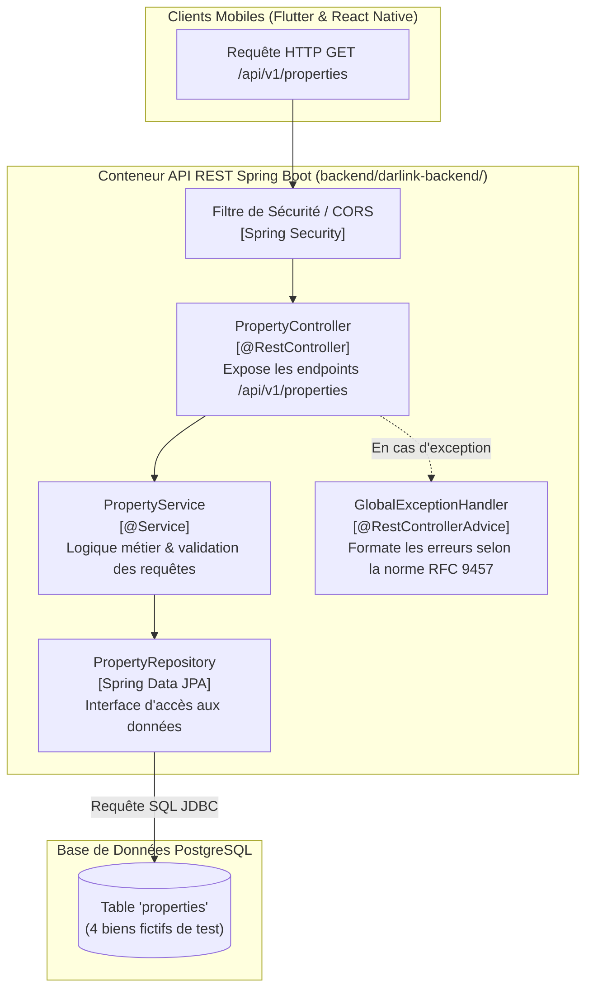

# C4 NIVEAU 3 — DIAGRAMME DES COMPOSANTS (COMPONENT DIAGRAM)

Ce diagramme détaille les composants logiciels internes du conteneur Backend Spring Boot 3 et leur interaction avec les couches mobiles et la persistance.

---

## 1. COMPOSANTS INTERNES DU BACKEND SPRING BOOT (CIBLE V3 / V5)

---

## 2. DESCRIPTION DES COMPOSANTS BACKEND

| Composant | Annotation / Type | Rôle technique et métier |
|---|---|---|
| **PropertyController** | `@RestController` | Réceptionne les requêtes HTTP, valide les paramètres d'interrogation (`@Valid`) et retourne les DTOs JSON. |
| **PropertyService** | `@Service` | Contient les règles de gestion, l'orchestration métier et l'application des filtres de recherche. |
| **PropertyRepository** | `JpaRepository` | Abstraction Spring Data JPA pour les opérations CRUD et la pagination sans code SQL brut. |
| **GlobalExceptionHandler** | `@RestControllerAdvice` | Intercepte les exceptions (`ResourceNotFoundException`, `MethodArgumentNotValidException`) et génère une réponse conforme à la **RFC 9457** (`application/problem+json`). |

---

## 3. COUPLAGE AVEC LES COMPOSANTS MOBILES

Côté Flutter et React Native, les composants de présentation (écrans `HomeScreen`, `SearchScreen`, `PropertyDetailsScreen`) interagissent avec une couche de données dédiée :
- **Flutter :** `PropertyRemoteDataSource` $\rightarrow$ `ApiClient` (gestion des headers, timeouts, et désérialisation via `PropertyModel.fromJson`).
- **React Native :** `propertyApi` $\rightarrow$ `apiClient` (instance Axios avec intercepteur d'erreurs et typage `interface Property`).

