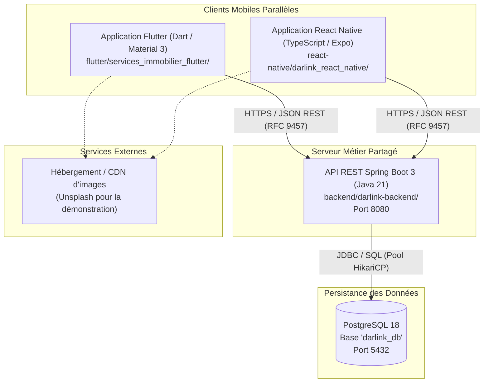

# VUE D'ENSEMBLE DE L'ARCHITECTURE SYSTÈME (SYSTEM OVERVIEW)

---

## 1. ARCHITECTURE GLOBALE EN COUCHES ET CONTENEURS

Le système DarLink repose sur une architecture distribuée moderne séparant clairement l'expérience utilisateur mobile et le traitement métier centralisé :

---

## 2. PRINCIPES ARCHITECTURAUX FONDAMENTAUX

1. **Dualité Cross-Platform :** Flutter et React Native sont deux implémentations autonomes partageant le même périmètre fonctionnel. Elles ne partagent aucun code source direct mais consomment les mêmes contrats d'API et appliquent le même système de design.
2. **Couplage faible (Loose Coupling) :** Les applications mobiles ignorent l'implémentation interne du backend. Elles dépendent uniquement des contrats REST documentés dans [`docs/API/API_CONTRACTS.md`](../API/API_CONTRACTS.md).
3. **Stateless API :** L'API Spring Boot est conçue sans état de session HTTP (stateless). L'authentification future (V4) utilisera des jetons JWT transmis dans le header `Authorization: Bearer <token>`.
4. **Persistance robuste et versionnée :** Toute modification du schéma PostgreSQL s'effectue via des scripts Flyway ordonnés et testés, garantissant la reproductibilité sur n'importe quel poste de travail.

