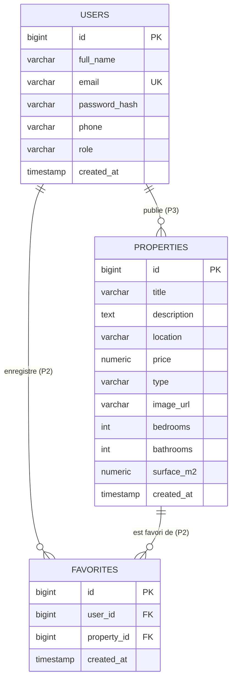

# RELATIONS ET CARDINALITÉS DE LA BASE (DATABASE RELATIONSHIPS)

---

## 1. MODÈLE ENTITÉ-ASSOCIATION (CIBLE MVP ET EXTENSIONS)

---

## 2. EXPLICATION DES CARDINALITÉS

- **Pour le MVP P1 (Version 5) :** La table `properties` fonctionne de manière autonome avec les 4 biens fictifs de démonstration.
- **Pour l'extension P2 (Version 6) :** Un utilisateur peut enregistrer zéro, un ou plusieurs biens en favoris (`1:N`). Un bien immobilier peut être mis en favori par zéro, un ou plusieurs utilisateurs (`1:N`). La table de liaison `favorites` garantit l'unicité du couple `(user_id, property_id)`.

