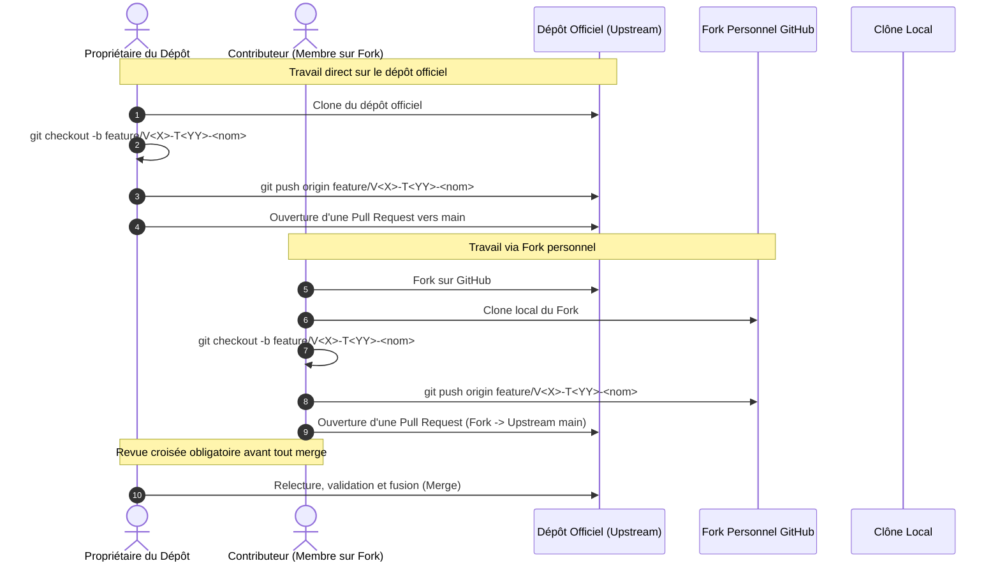

# MÉTHODOLOGIE DE DÉVELOPPEMENT ET CONVENTIONS TECHNIQUES

---

## 1. ADAPTATION DE SCRUM AU CONTEXTE UNIVERSITAIRE

Le projet DarLink applique une méthodologie agile inspirée de Scrum, rythmée par des sprints hebdomadaires adaptés à la date butoir du **26 novembre 2026** :

1. **Sprint Planning :** Découpage de la version en tâches précises dotées de 3 assignations techniques.
2. **Développement en branches isolées :** Respect absolu de la matrice de rotation tripartite.
3. **Revue croisée de Pull Request :** Examen du code par au moins un pair avant tout merge sur `main`.
4. **Intégration continue locale :** Exécution manuelle et rigoureuse des analyses statiques et tests unitaires.
5. **Sprint Review & Rétrospective :** Démonstration du flux fonctionnel et mise à jour des documents de passation.

---

## 2. WORKFLOW GITHUB (FORKING WORKFLOW)



### Règles absolues Git :
- **Aucun commit direct sur `main`.**
- **Nommage des branches :** `feature/V<X>-T<YY>-<description>` (ex: `feature/V2-T01-rn-init`) ou `fix/V<X>-T<YY>-<description>`.
- **Contenu d'une Pull Request :** Une PR doit obligatoirement détailler la tâche couverte, le membre assigné, les fichiers modifiés et les preuves d'exécution des tests.

---

## 3. CONVENTIONS D'ARCHITECTURE ET DE CODE

### 3.1 Application Flutter (`flutter/services_immobilier_flutter/`)
- **Langage :** Dart 3 (SDK `^3.13.4`).
- **Framework UI :** Material 3 (`useMaterial3: true`).
- **Structure modulaire :** `lib/core/` (thèmes, réseau, composants génériques) et `lib/features/` (modules métier : propriétés, navigation).
- **Contrôle de qualité :** `flutter analyze` doit obligatoirement retourner `0 issue`.

### 3.2 Application React Native (`react-native/darlink_react_native/`)
- **Langage :** TypeScript avec typage strict (`strict: true` dans `tsconfig.json`).
- **Framework :** React Native avec Expo (Bare/Managed).
- **Structure miroir :** `src/core/` et `src/features/`.
- **Contrôle de qualité :** `npx tsc --noEmit` doit s'exécuter sans aucune erreur de type.

### 3.3 Backend partagé (`backend/darlink-backend/`)
- **Langage & Framework :** Java 21 LTS avec Spring Boot 3.3.x et Maven.
- **Architecture en couches étanches :** `controller` $\rightarrow$ `service` $\rightarrow$ `repository` $\rightarrow$ `entity`.
- **Objets de transfert (DTO) :** Les entités JPA de persistance ne sont jamais exposées directement dans l'API publique.
- **Validation des données :** Validation déclarative avec Jakarta Bean Validation (`@NotNull`, `@Size`, `@Positive`).
- **Format d'erreur standard :** Conformité stricte à la norme **RFC 9457** (`application/problem+json`).

---

## 4. GESTION DES ERREURS : NORME RFC 9457

Toutes les erreurs retournées par l'API REST Spring Boot suivent le format normalisé **RFC 9457** avec le header HTTP `Content-Type: application/problem+json` :

```json
{
  "type": "https://api.darlink.tn/errors/not-found",
  "title": "Ressource introuvable",
  "status": 404,
  "detail": "Le bien immobilier avec l'identifiant 42 n'existe pas.",
  "instance": "/api/v1/properties/42",
  "timestamp": "2026-11-18T20:50:00Z"
}
```

Les deux applications mobiles (Flutter et React Native) intègrent un parseur dédié pour afficher le champ `detail` de manière conviviale à l'utilisateur.

