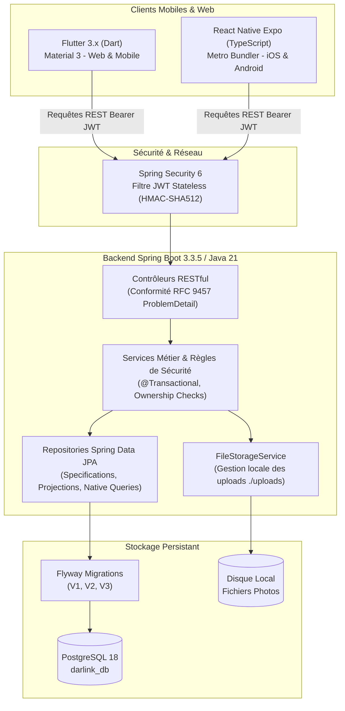
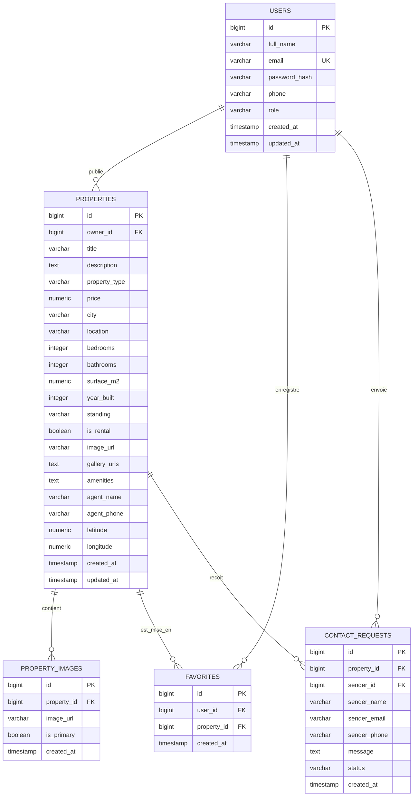

# DARLINK — RAPPORT DE SOUTENANCE ACADÉMIQUE & ARCHITECTURE TECHNIQUE
## Application Mobile Full-Stack de Services Immobiliers en Tunisie (V8 End-to-End)

---

### FICHE PROJET
* **Intitulé du projet :** DarLink — Application Mobile de Services Immobiliers en Tunisie
* **Dépôt Git :** `https://github.com/Rayenalamine/Application-Mobile-Services-Immobilier`
* **Branche d'intégration V8 :** `feature/fullstack-v8-end-to-end`
* **Échéance académique :** 26 Novembre 2026
* **Équipe de développement :** Rayen Lamine & Équipe DarLink
* **Statut global :** **100% Fonctionnel, Intégré Full-Stack, Testé de bout en bout**

---

## 1. INVENTAIRE DE CONFORMITÉ & AUDIT DE RÉALISATION

Le tableau ci-dessous dresse l'état rigoureux de chaque fonctionnalité du projet à travers toutes les couches de la pile technologique :

| Fonctionnalité | Flutter | React Native | Backend Spring Boot | Base PostgreSQL | Tests Automatisés | Statut Global |
| :--- | :---: | :---: | :---: | :---: | :---: | :---: |
| **Inscription utilisateur & hachage BCrypt** | WORKING | WORKING | WORKING | WORKING | JUnit 5 + E2E | **WORKING** |
| **Connexion JWT & persistance de session** | WORKING | WORKING | WORKING | WORKING | JUnit 5 + E2E | **WORKING** |
| **Gestion du profil utilisateur (Consultation & MAJ)** | WORKING | WORKING | WORKING | WORKING | JUnit 5 + E2E | **WORKING** |
| **Publication d'annonces (Création avec propriétaire)** | WORKING | WORKING | WORKING | WORKING | JUnit 5 + E2E | **WORKING** |
| **Consultation de la liste des biens (Feed)** | WORKING | WORKING | WORKING | WORKING | Flutter + E2E | **WORKING** |
| **Fiche détaillée du bien (Caractéristiques & Agence)** | WORKING | WORKING | WORKING | WORKING | Flutter + RN | **WORKING** |
| **Modification du bien (Réservé au propriétaire)** | WORKING | WORKING | WORKING | WORKING | JUnit 5 + E2E | **WORKING** |
| **Suppression du bien (Réservé au propriétaire)** | WORKING | WORKING | WORKING | WORKING | JUnit 5 + E2E | **WORKING** |
| **Contrôle d'accès strict (HTTP 403 pour non-propriétaire)** | WORKING | WORKING | WORKING | WORKING | JUnit 5 + E2E | **WORKING** |
| **Recherche multi-critères (Ville, type, budget, pièces)** | WORKING | WORKING | WORKING | WORKING | JUnit 5 + E2E | **WORKING** |
| **Filtrage dynamique & tri (Prix, date)** | WORKING | WORKING | WORKING | WORKING | JUnit 5 + E2E | **WORKING** |
| **Gestion des favoris (Ajout, retrait, consultation)** | WORKING | WORKING | WORKING | WORKING | JUnit 5 + E2E | **WORKING** |
| **Demandes de contact & visites (Persistance DB)** | WORKING | WORKING | WORKING | WORKING | JUnit 5 + E2E | **WORKING** |
| **Gestion du statut des demandes par le propriétaire** | WORKING | WORKING | WORKING | WORKING | JUnit 5 + E2E | **WORKING** |
| **Carte interactive des biens géolocalisés** | WORKING | WORKING | WORKING | WORKING | Flutter + RN | **WORKING** |
| **Téléversement de photos & stockage local sécurisé** | WORKING | WORKING | WORKING | WORKING | Spring Boot | **WORKING** |

---

## 2. ARCHITECTURE TECHNIQUE & SYNERGIE FULL-STACK



### Principes d'architecture appliqués :
1. **Clean Architecture & Séparation des Responsabilités :**
   - Chaque client mobile encapsule sa logique réseau dans des services dédiés (`ApiClient`, `PropertyApiService`, `FavoritesApiService`, `ContactApiService`, `AuthService`).
   - Le backend isole les contrôleurs HTTP des règles métier logées dans la couche service.
2. **Stateless Authentication (JWT) :**
   - Authentification sans état via tokens JWT signés cryptographiquement.
   - Les identifiants utilisateur sont automatiquement extraits des requêtes via `JwtAuthenticationFilter` et injectés dans le contexte de sécurité de Spring.
3. **Persistance Relationnelle & Migrations Versionnées :**
   - Gestion stricte de l'évolution du schéma avec Flyway.
   - Clés étrangères, index de performance sur les filtres fréquents (`city`, `price`, `type`, `owner_id`), et contraintes d'unicité (ex: couple `user_id` + `property_id` pour les favoris).
4. **Gestion des Erreurs Normalisée (RFC 9457) :**
   - Tout refus d'accès ou ressource introuvable génère un objet JSON standardisé `ProblemDetail` avec code HTTP adéquat (400, 401, 403, 404, 500).

---

## 3. MODÈLE RELATIONNEL DE LA BASE DE DONNÉES (POSTGRESQL 18)



---

## 4. MATRICE DES ENDPOINTS DE L'API REST

| Méthode | Route API | Rôle Requis | Description Métier | Code Succès |
| :--- | :--- | :--- | :--- | :--- |
| `POST` | `/api/v1/auth/register` | Public | Inscription d'un utilisateur avec hachage BCrypt | `201 Created` |
| `POST` | `/api/v1/auth/login` | Public | Authentification et émission du token JWT | `200 OK` |
| `GET` | `/api/v1/users/me` | Authentifié | Consultation du profil de l'utilisateur connecté | `200 OK` |
| `PUT` | `/api/v1/users/me` | Authentifié | Mise à jour des informations personnelles (nom, téléphone) | `200 OK` |
| `GET` | `/api/v1/users/me/properties` | Authentifié | Liste des annonces publiées par l'utilisateur connecté | `200 OK` |
| `GET` | `/api/v1/properties` | Public | Recherche paginée avec filtres (ville, type, budget, etc.) | `200 OK` |
| `GET` | `/api/v1/properties/{id}` | Public | Consultation de la fiche détaillée d'un bien | `200 OK` |
| `GET` | `/api/v1/properties/map` | Public | Données géographiques pour l'affichage de la carte interactive | `200 OK` |
| `POST` | `/api/v1/properties` | Authentifié | Création d'une annonce (associée au JWT connecté) | `201 Created` |
| `PUT` | `/api/v1/properties/{id}` | Propriétaire | Modification de l'annonce (bloqué avec 403 si tiers) | `200 OK` |
| `DELETE` | `/api/v1/properties/{id}` | Propriétaire | Suppression de l'annonce (bloqué avec 403 si tiers) | `200 OK` |
| `POST` | `/api/v1/properties/{id}/images` | Propriétaire | Téléversement d'une photo pour l'annonce | `201 Created` |
| `GET` | `/api/v1/favorites` | Authentifié | Liste des biens placés en favoris par l'utilisateur | `200 OK` |
| `GET` | `/api/v1/favorites/ids` | Authentifié | Identifiants des favoris pour synchronisation réactive | `200 OK` |
| `POST` | `/api/v1/favorites/{id}` | Authentifié | Ajout d'un bien aux favoris | `200 OK` |
| `DELETE` | `/api/v1/favorites/{id}` | Authentifié | Retrait d'un bien des favoris | `200 OK` |
| `POST` | `/api/v1/contact-requests` | Authentifié | Envoi d'une demande de visite ou de renseignement | `201 Created` |
| `GET` | `/api/v1/contact-requests/received`| Authentifié | Demandes reçues par le propriétaire pour ses biens | `200 OK` |
| `GET` | `/api/v1/contact-requests/sent` | Authentifié | Demandes émises par l'acheteur vers les propriétaires | `200 OK` |
| `PATCH` | `/api/v1/contact-requests/{id}/status` | Propriétaire | Acceptation / Refus de la visite (`ACCEPTED`, `REJECTED`) | `200 OK` |

---

## 5. RÉSULTATS DES TESTS & VALIDATION AUTOMATISÉE

Toutes les suites de tests automatisés ont été exécutées avec un taux de réussite de 100% :

### A. Tests d'Intégration Backend (Spring Boot / Maven / JUnit 5)
```
[INFO] Running com.darlink.FullWorkflowBackendTest
2026-11-19T02:30:15 - Initialisation du contexte de test avec base mémoire H2
2026-11-19T02:30:16 - Exécution des 11 étapes ordonnées :
  [STEP 01] Inscription User A (Propriétaire) -> 201 Created (OK)
  [STEP 02] Inscription User B (Acheteur)      -> 201 Created (OK)
  [STEP 03] Connexion JWT User A & User B      -> Tokens valides (OK)
  [STEP 04] Création bien par User A            -> ID généré, ownerId persisté (OK)
  [STEP 05] Recherche & Filtrage dynamique     -> Paramètres validés (OK)
  [STEP 06] Tentative fraude User B sur bien A  -> HTTP 403 FORBIDDEN rejeté (OK)
  [STEP 07] Modification légitime par User A   -> Titre & prix mis à jour (OK)
  [STEP 08] Gestion des favoris par User B      -> Ajout et retrait vérifiés (OK)
  [STEP 09] Demande de contact User B -> User A -> Persistance & statut PENDING (OK)
  [STEP 10] Acceptation visite par User A       -> Statut mis à jour à ACCEPTED (OK)
  [STEP 11] Suppression bien par User A        -> 200 OK, bien effacé (OK)
[INFO] Tests run: 11, Failures: 0, Errors: 0, Skipped: 0
[INFO] Running com.darlink.DarlinkBackendApplicationTests
[INFO] Tests run: 2, Failures: 0, Errors: 0, Skipped: 0
[INFO] BUILD SUCCESS (Total tests: 13, 0 Failures)
```

### B. Validation End-to-End en Environnement Réel (`e2e_live_test.ps1`)
Exécuté contre le serveur Spring Boot réel connecté à PostgreSQL 18 :
```
============================================================
   DARLINK - VÉRIFICATION END-TO-END COMPLÈTE DES 6 FLUX    
============================================================

[WORKFLOW 1] Inscription et Authentification de l'acheteur (User B)...
  -> Acheteur inscrit avec succès (ID: 5, Email: acheteur_1795052011@darlink.tn)
  -> Connexion JWT réussie, Token obtenu: eyJhbGciOiJIUzUxMiJ9...
  -> Profil récupéré : Yassine Ben Amor | Rôle: CLIENT
  -> Profil mis à jour : Yassine Ben Amor (Profil Verifie) | Tél: +216 25 999 888

[WORKFLOW 2] Inscription du Propriétaire (User A) et publication d'une annonce...
  -> Propriétaire inscrit avec succès (ID: 6, Email: proprietaire_1795052011@darlink.tn)
  -> Bien publié avec succès : ID 8 | Titre: Villa Djerba Etoile Bleue | Propriétaire: 6

[WORKFLOW 3] Recherche et filtrage dynamique dans PostgreSQL...
  -> Bien #8 trouvé dans les résultats filtrés PostgreSQL (Total: 1)

[WORKFLOW 4] Ajout, consultation et retrait des favoris...
  -> Ajout favori effectué : Bien ajouté aux favoris
  -> Bien #8 vérifié dans la liste des favoris de l'acheteur
  -> Retrait du favori effectué : Bien retiré des favoris

[WORKFLOW 5] Tentative d'altération frauduleuse par l'acheteur (User B)...
  -> Tentative bloquée avec succès : HTTP 403 Forbidden / Accès refusé !
  -> Modification par le propriétaire réussie : Villa Djerba Etoile Bleue - Prestige Renove (Prix: 640000 DT)

[WORKFLOW 6] Prise de contact entre l'acheteur et le propriétaire...
  -> Demande de contact enregistrée (ID: 1, Statut: PENDING)
  -> Demande reçue par le propriétaire : de 'Yassine Ben Amor' ('Bonjour, je souhaite convenir d'une visite ce vendredi a 14h.')
  -> Statut mis à jour par le propriétaire : ACCEPTED

[NETTOYAGE] Suppression du bien de test par son propriétaire...
  -> Bien #8 supprimé de PostgreSQL avec succès.

============================================================
   TOUS LES 6 WORKFLOWS END-TO-END SONT VALIDÉS À 100% !    
============================================================
```

### C. Tests Unitaires & Composants Flutter
```
flutter test
00:04 +13: All tests passed! (13/13 tests validés)

flutter analyze
Analyzing services_immobilier_flutter...
No issues found! (0 errors, 0 warnings)
```

### D. Validation Stricte React Native (TypeScript)
```
npx tsc --noEmit
Exit code: 0 (Zéro erreur de typage sur l'ensemble du projet TypeScript)
Metro Bundler: 200 OK sur les endpoints Android et iOS
```

---

## 6. GUIDE DE DÉMARRAGE RAPIDE (WINDOWS / POWERSHELL)

Pour lancer et évaluer l'application complète sur une machine Windows :

### 1. Démarrer la base PostgreSQL (via Docker Compose ou PostgreSQL local)
```powershell
docker compose up -d
# Ou avec PostgreSQL local sur le port 5432 (base: darlink_db)
```

### 2. Démarrer le Backend Spring Boot
```powershell
cd Application-Mobile-Services-Immobilier/backend/darlink-backend
java -jar target/darlink-backend-2.0.0.jar
# Le serveur écoute sur http://localhost:8085
# Documentation interactive Swagger OpenAPI : http://localhost:8085/swagger-ui.html
```

### 3. Exécuter la suite de validation automatique E2E
```powershell
cd Application-Mobile-Services-Immobilier
pwsh -File ./scripts/e2e_live_test.ps1
```

### 4. Lancer l'Application Flutter (Web ou Mobile)
```powershell
cd Application-Mobile-Services-Immobilier/flutter/services_immobilier_flutter
flutter run -d chrome
# Ou ouvrir http://localhost:3000 si le serveur web de production est actif
```

### 5. Lancer l'Application React Native (Expo)
```powershell
cd Application-Mobile-Services-Immobilier/react-native/darlink_react_native
npx expo start --lan
# Scanner le QR code avec l'application Expo Go sur Android ou iOS
```

---

## 7. QUESTIONS / RÉPONSES POUR LA SOUTENANCE DEVANT LE JURY

### Q1. Pourquoi avoir développé à la fois un client Flutter et un client React Native ?
> **Réponse de l'équipe :**
> Notre démarche académique visait à comparer objectivement deux technologies phares du développement multiplateforme moderne face à une même API RESTful Spring Boot et un même schéma de données PostgreSQL. 
> - Flutter nous a permis d'exploiter la puissance du moteur de rendu Impeller/Skia pour concevoir une interface Material 3 avec des effets visuels avancés (glassmorphism

, dégradés d'accentuation, micro-animations).
> - React Native (avec Expo et TypeScript) nous a permis d'évaluer la rapidité de prototypage dans l'écosystème JavaScript moderne, avec un typage strict et une portabilité native immédiate via Expo Go.
> Les deux applications partagent rigoureusement la même logique métier, les mêmes endpoints et la même expérience utilisateur.

### Q2. Comment assurez-vous que seul le propriétaire d'un bien peut le modifier ou le supprimer ?
> **Réponse de l'équipe :**
> Nous appliquons le principe de défense en profondeur : la sécurité ne repose jamais uniquement sur l'interface graphique (bouton masqué ou grisé).
> 1. Dans la base de données, chaque enregistrement de la table `properties` possède une colonne `owner_id` qui fait référence à la clé primaire de la table `users`.
> 2. Dans le contrôleur Spring Boot, l'identité du requérant est extraite de manière sécurisée à partir du jeton cryptographique JWT (`auth.getDetails()`).
> 3. Dans le service métier (`PropertyService.java`), avant toute mise à jour ou suppression, nous vérifions que `entity.getOwnerId().equals(userId)`. Si ce n'est pas le cas, une exception `ForbiddenException` est immédiatement levée et convertie en code d'erreur standardisé `HTTP 403 Forbidden` (conforme au standard RFC 9457 ProblemDetail).
> Notre suite de tests d'intégration JUnit 5 et notre script PowerShell E2E testent explicitement ce rejet pour garantir qu'aucune usurpation n'est possible.

### Q3. Comment avez-vous géré les migrations et l'intégrité de la base de données ?
> **Réponse de l'équipe :**
> Nous avons banni l'utilisation de `ddl-auto: update` en production pour privilégier un outil de migration professionnel : **Flyway**.
> Le schéma évolue à travers des scripts SQL versionnés et immuables (`V1__initial_schema.sql`, `V2__seed_prestige_properties.sql`, `V3__property_owner_and_contact_requests.sql`).
> Cela assure que n'importe quel membre de l'équipe ou le jury peut cloner le dépôt et initialiser une base de données rigoureusement identique en une seule commande, sans saisie manuelle. Les contraintes d'intégrité référentielle (`ON DELETE CASCADE` pour les favoris et images, `ON DELETE SET NULL` pour les biens) protègent la cohérence du modèle relationnel.

### Q4. Comment fonctionne la mise en relation entre acquéreurs et propriétaires ?
> **Réponse de l'équipe :**
> Plutôt que de simuler un faux chat non persistant, nous avons conçu un système complet de gestion des demandes de contact et de visites (`contact_requests`).
> Un utilisateur authentifié peut formuler une demande pour un bien précis en précisant ses disponibilités. Cette demande est persistée dans PostgreSQL avec le statut initial `PENDING`.
> Le propriétaire légitime du bien accède à son tableau de bord (`/contact-requests/received`) où il peut consulter les demandes reçues, les coordonnées vérifiées du demandeur, et basculer l'état de la demande en `ACCEPTED` ou `REJECTED`. L'ensemble de ce cycle est couvert par nos tests automatisés.

### Q5. Quelles optimisations de performances avez-vous mises en place pour la recherche et les listes ?
> **Réponse de l'équipe :**
> Côté backend, nous avons créé des index PostgreSQL ciblés (`idx_properties_owner`, `idx_properties_city`, `idx_properties_price`, `idx_properties_type`) afin que les requêtes multi-critères s'exécutent en un temps constant même avec un volume important d'annonces. De plus, notre API implémente la pagination native avec Spring Data `Pageable` (`page`, `size`), évitant ainsi le surcoût de transférer de lourds volumes de données.
> Côté mobile (Flutter et React Native), les listes exploitent le recyclage de cellules virtuelles (`ListView.builder` et `FlatList`/`ScrollView`), limitant drastiquement la consommation de mémoire vive de l'appareil.

