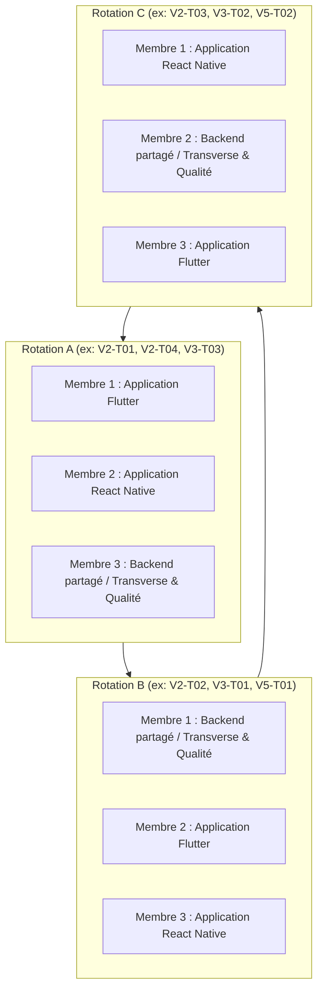

# ORGANISATION DE L'ÉQUIPE ET MATRICE DE ROTATION (TEAM ROLES)

---

## 1. COMPOSITION ET CARTOGRAPHIE DE L'ÉQUIPE

L'équipe universitaire est composée de **trois étudiants** dont les rôles formels sont arrêtés comme suit :

| Identifiant dans le projet | Rôle fonctionnel & Rôle Git | Responsabilités principales |
|---|---|---|
| **Membre 1** | **Propriétaire du Dépôt (Repository Owner)** | Responsable du dépôt officiel GitHub `Rayenalamine/Application-Mobile-Services-Immobilier`, de la gestion des branches amont, de la revue finale et du merge des Pull Requests. Participant actif au développement. |
| **Membre 2** | **Coéquipier 1 (Teammate 1)** | Travaille via son Fork personnel GitHub. Soumet ses branches et Pull Requests vers le dépôt officiel. Participant actif au développement et à la revue croisée. |
| **Membre 3** | **Coéquipier 2 (Teammate 2)** | Travaille via son Fork personnel GitHub. Soumet ses branches et Pull Requests vers le dépôt officiel. Participant actif au développement et à la revue croisée. |

> [!NOTE]
> Cette cartographie formelle (`Propriétaire du Dépôt = Membre 1`, `Coéquipier 1 = Membre 2`, `Coéquipier 2 = Membre 3`) est définitivement confirmée. Elle garantit la traçabilité des contributions et des revues de code.

---

## 2. MATRICE DE ROTATION OBLIGATOIRE (ANTI-SPÉCIALISATION)

Pour garantir qu'aucun étudiant ne devienne l'unique détenteur du savoir sur une technologie, les rôles tournent systématiquement d'une tâche à l'autre selon trois rotations types :

| Cycle de rotation | Membre 1 | Membre 2 | Membre 3 |
|---|---|---|---|
| **Rotation A** | Application Flutter | Application React Native | Backend partagé / Architecture transverse / Qualité |
| **Rotation B** | Backend partagé / Architecture transverse / Qualité | Application Flutter | Application React Native |
| **Rotation C** | Application React Native | Backend partagé / Architecture transverse / Qualité | Application Flutter |

---

## 3. RÔLES EN SESSIONS COLLABORATIVES (MOB / PAIR PROGRAMMING)

Pour les étapes architecturales critiques (comme l'approbation du contrat d'API V5-T00 ou la configuration Flyway V3-T02), l'équipe pratique des sessions collaboratives avec rotation des rôles toutes les 20 à 30 minutes :
- **Le Driver (Conducteur) :** Tient le clavier et écrit le code validé par l'équipe.
- **Le Navigator (Navigateur) :** Guide la logique, anticipe les difficultés et dicte la structure technique.
- **Le Reviewer (Vérificateur) :** Vérifie le respect des conventions, la conformité au contrat d'API et la complétude des tests.

---

## 4. PRÉPARATION À LA SOUTENANCE DEVANT L'ENSEIGNANT

M. Wahid Hamdi évaluera la maîtrise individuelle de chaque étudiant. En conséquence :
- Chaque membre doit être capable d'expliquer n'importe quelle portion du code (Flutter, React Native ou Spring Boot), et non seulement les fichiers qu'il a directement écrits.
- Les revues croisées de code (Code Reviews) sur chaque Pull Request sont obligatoires pour garantir l'appropriation collective.

