# FEUILLE DE ROUTE OFFICIELLE DU PROJET (VERSION ROADMAP)

**Échéance académique :** 26 novembre 2026 (dans 8 jours)  
**Objectif prioritaire :** Livraison d'un MVP démontrable de bout en bout (**End-to-End Core Flow**).

---

## 1. STRUCTURE DE PRIORISATION (P1 / P2 / P3)

```mermaid
flowchart LR
    subgraph P1 ["P1 : MVP OBLIGATOIRE (Soutenance 26 Nov)"]
        direction TB
        V1_F["V1 : Prototype Flutter statique (Achevé ✅)"]
        V2_F["V2 : Socle React Native & Design System"]
        V3_F["V3 : Socle Spring Boot 3 + PostgreSQL"]
        V5_T00["V5-T00 : Spécification Contrat d'API partagé"]
        V5_F["V5 : API REST Properties & Double consommation mobile"]
        C4_F["Documentation C4 Niveaux 1 à 3 synchronisée"]
    end

    subgraph P2 ["P2 : EXTENSIONS SOUS CONDITION (Si P1 terminé avant le 24 Nov)"]
        direction TB
        V4_F["V4 : Authentification JWT basique (Login/Register)"]
        V6_F["V6 : Écran Détails enrichi & Favoris"]
    end

    subgraph P3 ["P3 : FEUILLE DE ROUTE POST-SOUTENANCE (Vision future)"]
        direction TB
        V7_F["V7 : Dépôt d'annonces multi-photos"]
        V8_F["V8 : Cartographie interactive & Géolocalisation"]
        V9_F["V9 : Messagerie instantanée sécurisée"]
        V10_F["V10 : Notifications in-app"]
        V11_F["V11 : Administration & Modération"]
        V12_F["V12 : Tests E2E complets & Caching"]
        V13_F["V13 : Clôture long terme"]
    end

    P1 -->|Si temps disponible| P2
    P2 -.->|Feuille de route future| P3
```



---

## 2. DÉTAIL DES PHASES DU PROJET

### 2.1 P1 — Le Cœur du MVP (Obligatoire pour le 26 Novembre)

Le cœur non-négociable du projet est d'assurer la chaîne de données complète :
```text
[Applications Mobiles (Flutter & React Native)] 
               │
               ▼ (Requête HTTP / JSON REST)
[Serveur Spring Boot 3 (Java 21 / Maven)] 
               │
               ▼ (JDBC / Connexion locale port 5432)
[Base de données relationnelle PostgreSQL (darlink_db)]
```

- **V1 — Prototype Flutter statique [ACHEVÉ] :**
  - Emplacement : `flutter/services_immobilier_flutter/`.
  - Contient 4 biens fictifs utilisés comme données de démonstration et de test.
- **V2 — Socle mobile parallèle & Système de design professionnel :**
  - Initialisation de `react-native/darlink_react_native/` en TypeScript avec Expo.
  - Système de thèmes clair/sombre et composants UI partagés.
  - Parité visuelle complète de l'écran d'accueil entre Flutter et React Native.
- **V3 — Socle Backend Spring Boot 3 & PostgreSQL :**
  - Initialisation de `backend/darlink-backend/` en Java 21 / Maven.
  - Démarrage vérifié du service Windows PostgreSQL `postgresql-x64-18` et base `darlink_db`.
  - Première migration Flyway `V1__init_schema.sql` et test d'intégration DataSource.
  - Spécification OpenAPI / Swagger UI et gestion d'erreur normalisée **RFC 9457**.
- **V5-T00 — Définition et Approbation du Contrat d'API Partagé :**
  - Élaboration tripartite de `docs/API/API_CONTRACTS.md` (schémas JSON, DTOs, codes d'erreur).
  - Validation préalable obligatoire par le propriétaire avant toute implémentation.
- **V5 — Découverte et Recherche de Biens via API REST :**
  - Endpoint `GET /api/v1/properties` et `GET /api/v1/properties/{id}` dans Spring Boot.
  - Insertion Flyway `V2__create_property_table.sql` des 4 biens fictifs de test.
  - Consommation et affichage dynamique dans Flutter ET React Native.

---

### 2.2 P2 — Extensions Fonctionnelles (Optionnelles selon Calendrier)

*Ces versions ne seront démarrées que si P1 est intégralement validé avant le 24 novembre :*
- **V4 — Authentification JWT & Profil Utilisateur :**
  - Endpoints `/register` et `/login`, hachage BCrypt, token JWT avec stockage sécurisé mobile (`flutter_secure_storage` et `expo-secure-store`).
- **V6 — Détails Enrichis & Système de Favoris :**
  - Galerie d'images glissante, lien d'appel téléphonique direct et persistance des favoris.

---

### 2.3 P3 — Feuille de Route Post-Soutenance (Résumés d'Orientation)

*Ces fonctionnalités représentent les évolutions futures présentées lors de la soutenance :*
- **V7 :** Dépôt d'annonces multi-photos avec validation de fichiers côté Spring Boot.
- **V8 :** Intégration de cartes géographiques interactives et recherche par rayon.
- **V9 :** Messagerie instantanée sécurisée entre acheteurs et propriétaires.
- **V10 :** Centre de notifications in-app et alertes immobilières.
- **V11 :** Rôle Administrateur, modération des annonces et traitement des signalements.
- **V12 :** Sécurité avancée, caching Redis, et suites de tests end-to-end (E2E).
- **V13 :** Packaging final et publication sur les magasins d'applications.

