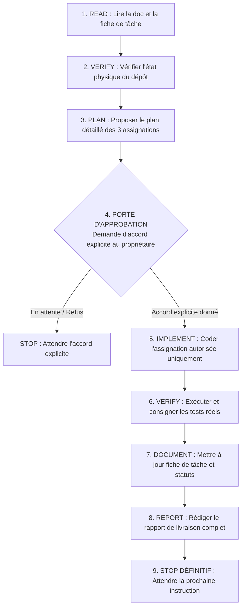

# PROTOCOLE STRICT D'EXÉCUTION DES TÂCHES (WORK PROTOCOL)

Ce protocole définit la méthode de travail obligatoire pour chaque membre de l'équipe et tout assistant IA intervenant sur le projet DarLink. Aucune dérogation n'est autorisée.

---

## 1. RÈGLE D'ISOLATION ET DE PROGRESSION UNITAIRE

1. **Une seule tâche à la fois :** Le travail s'effectue strictement tâche par tâche (ex: `V2-T01`).
2. **Isolation des membres :** Lorsqu'une assignation est demandée pour un membre donné, seuls les fichiers attribués à ce membre peuvent être modifiés. Il est strictement interdit d'implémenter l'assignation d'un autre membre sans autorisation explicite.
3. **Pas d'enchaînement automatique :** L'assistant ou l'étudiant doit s'arrêter (**STOP**) après chaque tâche ou assignation terminée.

---

## 2. LA SÉQUENCE D'EXÉCUTION EN 9 ÉTAPES

### Détail des 9 étapes :

- **ÉTAPE 1 — READ (Lecture) :** Lecture préalable de [`AI_ONBOARDING.md`](AI_ONBOARDING.md), [`PROJECT_CONTEXT.md`](PROJECT_CONTEXT.md), [`PROJECT_STATUS.md`](PROJECT_STATUS.md), [`WORK_PROTOCOL.md`](WORK_PROTOCOL.md) et de la fiche de la tâche visée dans `docs/TASKS/`.
- **ÉTAPE 2 — VERIFY (Vérification) :** Vérification physique de l'existence des fichiers, de l'état Git et des dépendances réelles. Ne jamais présumer de l'historique d'une conversation.
- **ÉTAPE 3 — PLAN (Planification) :** Présentation du plan de travail : objectif exact, assignation du membre, fichiers autorisés à être modifiés, fichiers strictement interdits, commandes de test prévues.
- **ÉTAPE 4 — WAIT WHEN NECESSARY (Porte d'approbation) :** **Arrêt obligatoire.** L'assistant attend la validation explicite du propriétaire du projet avant de modifier le moindre fichier.
- **ÉTAPE 5 — IMPLEMENT (Implémentation) :** Écriture du code correspondant strictement à l'assignation autorisée. Interdiction d'ajouter des dépendances non approuvées ou de refactoriser du code non lié.
- **ÉTAPE 6 — VERIFY (Validation technique) :** Exécution réelle des commandes d'analyse et de tests dans le terminal. Copie intégrale des sorties de commandes. Interdiction d'affirmer qu'un test est réussi sans l'avoir exécuté.
- **ÉTAPE 7 — DOCUMENT (Documentation) :** Mise à jour de la fiche de tâche (`docs/TASKS/...`), de [`PROJECT_STATUS.md`](PROJECT_STATUS.md) et du registre de handoff [`docs/HANDOFF/CURRENT_HANDOFF.md`](HANDOFF/CURRENT_HANDOFF.md).
- **ÉTAPE 8 — REPORT (Rapport d'exécution) :** Synthèse remise au propriétaire indiquant les fichiers modifiés, ce qui a été fait, ce qui reste à faire, les résultats de tests réels et les limitations connues.
- **ÉTAPE 9 — STOP (Arrêt complet) :** Arrêt complet de l'intervention. Attente de la prochaine instruction du propriétaire.

---

## 3. DÉFINITION DE TERMINÉ (DEFINITION OF DONE - DoD)

Une tâche ne peut être déclarée `DONE` que lorsque :
- [ ] Les 3 assignations techniques ont été réalisées et intégrées sans conflit Git.
- [ ] Les chemins officiels du dépôt ont été respectés à la lettre (`flutter/services_immobilier_flutter/`, `react-native/darlink_react_native/`, `backend/darlink-backend/`).
- [ ] Le contrat d'API partagé respectant la RFC 9457 a été strictement suivi.
- [ ] Les analyses statiques et tests ont été exécutés avec succès dans l'environnement :
  - Flutter : `flutter analyze` (0 issue), `flutter test` (100% passés).
  - React Native : `npx tsc --noEmit` (0 issue TypeScript).
  - Spring Boot : `mvn test` (tests passés).
- [ ] L'environnement réel du test est clairement précisé (Web, Expo Go, AVD, etc.).
- [ ] La documentation de la tâche et [`PROJECT_STATUS.md`](PROJECT_STATUS.md) sont à jour.
- [ ] Les trois membres de l'équipe comprennent l'implémentation et sont capables de l'expliquer lors de la soutenance devant l'enseignant.