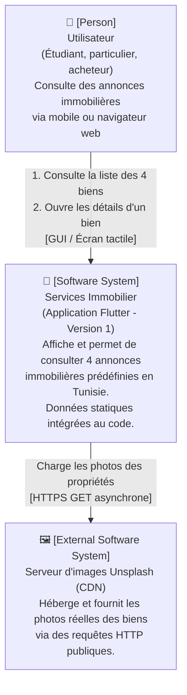
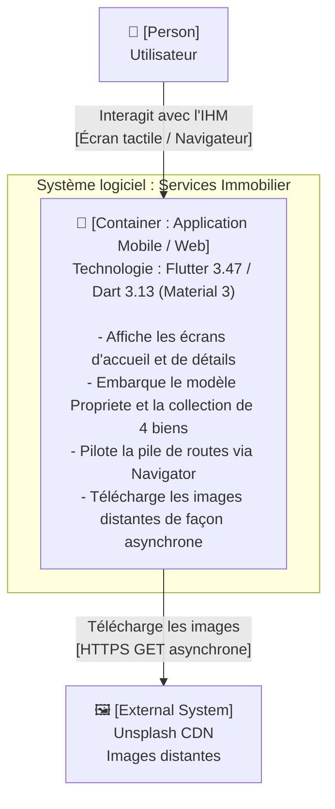
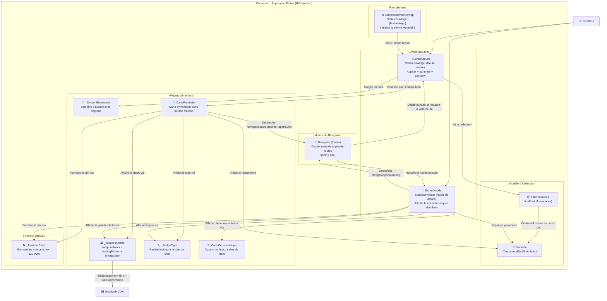

# Services Immobilier – Application Flutter

**Version 1 – Prototype fonctionnel de base**  
Mini-projet universitaire – Développement d'applications mobiles

---

## A. Présentation du projet

### Nom du projet
**Services Immobilier**

### Objectif
Notre application permet de consulter des annonces immobilières en Tunisie. L'utilisateur peut parcourir une liste de biens immobiliers, cliquer sur un bien pour voir ses détails, et revenir à la liste principale.

Ce mini-projet a été développé dans le cadre d'un cours universitaire de développement d'applications mobiles. L'objectif pédagogique est d'apprendre les bases de Flutter et Dart en construisant une application réelle, fonctionnelle et compréhensible.

### Technologies utilisées

| Technologie | Version | Rôle |
|-------------|---------|------|
| Flutter | 3.47.5 | Framework principal pour créer l'application mobile |
| Dart | 3.13.4 | Langage de programmation utilisé par Flutter |
| Material 3 | intégré à Flutter | Bibliothèque de composants graphiques (design) |

### Ce que la Version 1 permet de faire
- ✅ Afficher un écran d'accueil avec un message de bienvenue
- ✅ Afficher une liste de 4 annonces immobilières fictives
- ✅ Afficher une carte pour chaque propriété (image, titre, localisation, prix, type)
- ✅ Naviguer vers un écran de détails en cliquant sur "Voir détails"
- ✅ Afficher toutes les informations d'un bien (chambres, salles de bain, description)
- ✅ Revenir à la liste principale avec le bouton retour
- ✅ Afficher une image de remplacement si l'image ne peut pas se charger

### Ce qui n'est pas encore implémenté (versions futures)
- ❌ Authentification / inscription des utilisateurs
- ❌ Base de données ou serveur distant
- ❌ Ajout ou modification d'annonces (formulaire de publication)
- ❌ Recherche et filtrage des biens
- ❌ Favoris
- ❌ Carte géographique
- ❌ Messagerie entre utilisateurs
- ❌ Paiement
- ❌ Notifications

---

## B. Initialisation du projet

### Prérequis
Avant de commencer, nous avons vérifié que Flutter et Dart étaient bien installés sur notre machine avec les commandes suivantes :

```bash
flutter --version
dart --version
flutter doctor
```

### Création du projet

Nous avons créé le projet Flutter avec la commande officielle :

```bash
flutter create --project-name services_immobilier_flutter services_immobilier_flutter
```

Cette commande a généré automatiquement **131 fichiers**, dont la structure complète du projet.

Nous nous sommes ensuite placés dans le dossier du projet :

```bash
cd services_immobilier_flutter
```

### Lancement de l'application

Pour exécuter l'application sur un émulateur ou un appareil connecté :

```bash
flutter run
```

Pour exécuter uniquement dans le navigateur Chrome (si pas d'émulateur Android) :

```bash
flutter run -d chrome
```

---

## C. Structure du projet

### Vue d'ensemble

```
services_immobilier_flutter/
├── lib/
│   └── main.dart          ← MODIFIÉ PAR NOUS
├── test/
│   └── widget_test.dart   ← MODIFIÉ PAR NOUS
├── android/               ← Généré automatiquement (Android)
├── ios/                   ← Généré automatiquement (iOS)
├── web/                   ← Généré automatiquement (Web)
├── windows/               ← Généré automatiquement (Windows)
├── linux/                 ← Généré automatiquement (Linux)
├── macos/                 ← Généré automatiquement (macOS)
├── pubspec.yaml           ← Généré automatiquement (configuration)
├── pubspec.lock           ← Généré automatiquement (versions exactes)
├── analysis_options.yaml  ← Généré automatiquement (règles de code)
└── README.md              ← CRÉÉ PAR NOUS
```

### 1. Fichiers et dossiers générés automatiquement par Flutter

Flutter a créé tous ces fichiers et dossiers lors de l'exécution de `flutter create`. Nous ne les avons pas écrits manuellement.

| Fichier / Dossier | Description |
|-------------------|-------------|
| `android/` | Contient les fichiers natifs pour Android (Gradle, manifeste, etc.) |
| `ios/` | Contient les fichiers natifs pour iOS (Xcode, plist, etc.) |
| `web/` | Contient les fichiers pour la version web (index.html, icônes) |
| `windows/`, `linux/`, `macos/` | Fichiers natifs pour les plateformes bureau |
| `pubspec.yaml` | Fichier de configuration du projet (nom, dépendances, version) |
| `pubspec.lock` | Verrouille les versions exactes des packages utilisés |
| `analysis_options.yaml` | Règles d'analyse du code Dart |
| `lib/main.dart` | Fichier principal – Flutter le génère avec un exemple de compteur |
| `test/widget_test.dart` | Fichier de test – Flutter le génère avec un test basique |

### 2. Fichiers que nous avons modifiés

| Fichier | Ce que nous avons changé |
|---------|--------------------------|
| `lib/main.dart` | Nous avons **remplacé tout le contenu** par notre code (voir section D) |
| `test/widget_test.dart` | Nous avons **remplacé le test** par un test adapté à notre application |

### 3. Fichiers que nous avons créés nous-mêmes

| Fichier | Description |
|---------|-------------|
| `README.md` | Ce fichier de documentation (remplace le README généré par Flutter) |

---

## D. Développement étape par étape

### Étape 1 – Initialisation du projet

Nous avons exécuté `flutter create services_immobilier_flutter` dans le terminal. Flutter a généré automatiquement tous les fichiers nécessaires pour une application multi-plateforme. L'application générée par défaut était un compteur simple ("Flutter Demo Home Page").

### Étape 2 – Ouverture de `main.dart`

Nous avons ouvert le fichier `lib/main.dart` avec notre éditeur (VS Code ou Android Studio). Ce fichier est **le point d'entrée** de toute application Flutter. C'est là que nous avons écrit tout notre code pour la Version 1.

Nous avons supprimé tout le code par défaut (le compteur) et commencé à écrire notre application depuis zéro.

### Étape 3 – Configuration de `MaterialApp`

**Fichier modifié : `lib/main.dart`**

La première chose que nous avons faite dans `main.dart` est de configurer `MaterialApp`. C'est le widget racine de toute application Flutter utilisant Material Design.

```dart
void main() {
  runApp(const ServicesImmobilierApp());
}

class ServicesImmobilierApp extends StatelessWidget {
  const ServicesImmobilierApp({super.key});

  @override
  Widget build(BuildContext context) {
    return MaterialApp(
      title: 'Services Immobilier',
      debugShowCheckedModeBanner: false,
      theme: ThemeData(
        colorScheme: ColorScheme.fromSeed(
          seedColor: const Color(0xFF1565C0), // bleu principal
        ),
        useMaterial3: true,
      ),
      home: const EcranAccueil(),
    );
  }
}
```

- `runApp()` : lance l'application Flutter
- `MaterialApp` : configure le thème, le titre et l'écran de démarrage
- `ThemeData` : définit les couleurs et le style de l'application
- `useMaterial3: true` : utilise le design Material 3 (le plus récent)
- `home: const EcranAccueil()` : définit l'écran affiché au démarrage

### Étape 4 – Création de la classe `Propriete`

**Fichier modifié : `lib/main.dart`**

Nous avons créé une **classe Dart** appelée `Propriete` pour représenter un bien immobilier. Cette classe regroupe toutes les informations d'une propriété dans un seul objet.

```dart
class Propriete {
  final String titre;
  final String localisation;
  final double prix;
  final String type;
  final String imageUrl;
  final int nombreChambres;
  final int nombreSallesDeBain;
  final String description;

  const Propriete({
    required this.titre,
    required this.localisation,
    // ...
  });
}
```

**Pourquoi avons-nous créé cette classe ?**  
Sans classe, nous aurions dû gérer séparément des dizaines de variables (titre1, prix1, localisation1, titre2, prix2...). Avec la classe `Propriete`, chaque bien est un seul objet contenant toutes ses informations. C'est plus propre et plus facile à maintenir.

### Étape 5 – Création de la liste des propriétés

**Fichier modifié : `lib/main.dart`**

Nous avons créé une liste de 4 objets `Propriete` avec des données fictives situées en Tunisie :

```dart
final List<Propriete> listeProprietes = [
  const Propriete(
    titre: 'Appartement moderne à Tunis',
    localisation: 'Les Berges du Lac, Tunis',
    prix: 320000,
    type: 'Appartement',
    imageUrl: 'https://images.unsplash.com/...',
    nombreChambres: 3,
    nombreSallesDeBain: 2,
    description: '...',
  ),
  // ... 3 autres propriétés
];
```

Les 4 propriétés fictives sont situées à : **Tunis**, **Sousse**, **Djerba** et **Hammamet**.

**Précision technique essentielle sur le modèle de données en Dart :**
- **Variable `final` (`final List<Propriete> listeProprietes`) :** Le mot-clé `final` indique que la variable ne peut pas être réassignée à une autre liste après son initialisation (on ne peut pas écrire `listeProprietes = autreListe`). Cependant, la liste elle-même n'est pas déclarée comme constante (`const`), ce qui signifie que ses méthodes de mutation (comme `.add()` ou `.remove()`) resteraient techniquement accessibles, même si notre application ne les utilise pas.
- **Liste `const` (`const [...]`) :** Si nous avions écrit `final listeProprietes = const [...]`, la liste aurait été verrouillée à la compilation comme immuable au sens strict, et toute tentative d'ajout lèverait une exception `UnsupportedError` à l'exécution.
- **Objets `const Propriete(...)` :** Chaque élément individuel placé dans la liste est instancié avec `const` grâce au constructeur constant de la classe `Propriete`. Les données de chaque bien immobilier sont donc immuables en mémoire.

**Pourquoi des données statiques ?**  
Pour la Version 1, nous n'avons pas de base de données ni de serveur. Les données sont directement écrites dans le code source. L'application affiche uniquement ces 4 annonces prédéfinies et ne comporte pas de moteur de recherche ou de filtre. C'est suffisant pour démontrer le fonctionnement de l'interface.

### Étape 6 – Conception de l'écran d'accueil (`EcranAccueil`)

**Fichier modifié : `lib/main.dart`**

Nous avons créé la classe `EcranAccueil` qui affiche :
1. Une barre de titre (`AppBar`) avec le nom de l'application
2. Un message de bienvenue (`_SectionBienvenue`)
3. Un titre de section ("Nos biens immobiliers")
4. Une liste verticale des propriétés (`ListView.builder`)

```dart
class EcranAccueil extends StatelessWidget {
  const EcranAccueil({super.key});

  @override
  Widget build(BuildContext context) {
    return Scaffold(
      appBar: AppBar(title: const Text('Services Immobilier')),
      body: Column(
        children: [
          _SectionBienvenue(),
          // Titre "Nos biens immobiliers"
          Expanded(
            child: ListView.builder(
              itemCount: listeProprietes.length,
              itemBuilder: (context, index) {
                return CartePropriete(propriete: listeProprietes[index]);
              },
            ),
          ),
        ],
      ),
    );
  }
}
```

### Étape 7 – Création des cartes de propriétés (`CartePropriete`)

**Fichier modifié : `lib/main.dart`**

Nous avons créé le widget `CartePropriete` qui affiche les informations d'une propriété sous forme de carte visuelle :

- **Image** : chargée depuis une URL, avec un indicateur de chargement et une image de remplacement en cas d'erreur
- **Badge de type** : un étiquette colorée (Appartement / Maison / Villa)
- **Titre** du bien
- **Localisation** avec l'icône d'un marqueur de carte
- **Prix** en dinars tunisiens (TND), formaté avec des espaces (ex. 320 000)
- **Bouton "Voir détails"** pour naviguer vers l'écran de détails

Nous avons utilisé le widget `Image.network()` avec `errorBuilder` pour gérer les erreurs de chargement d'image.

### Étape 8 – Implémentation de l'écran de détails (`EcranDetails`)

**Fichier modifié : `lib/main.dart`**

Nous avons créé la classe `EcranDetails` qui reçoit un objet `Propriete` et affiche toutes ses informations :

```dart
class EcranDetails extends StatelessWidget {
  final Propriete propriete; // la propriété à afficher

  const EcranDetails({super.key, required this.propriete});

  @override
  Widget build(BuildContext context) {
    return Scaffold(
      appBar: AppBar(title: const Text('Détails du bien')),
      body: SingleChildScrollView(
        child: Column(
          children: [
            // Grande image, titre, localisation, prix,
            // caractéristiques, description, bouton retour
          ],
        ),
      ),
    );
  }
}
```

L'écran utilise `SingleChildScrollView` pour permettre le défilement si le contenu est plus long que l'écran.

### Étape 9 – Connexion des écrans avec `Navigator`

**Fichier modifié : `lib/main.dart`**

Pour naviguer de la liste vers les détails, nous avons utilisé `Navigator.push()` dans le bouton "Voir détails" :

```dart
onPressed: () {
  Navigator.push(
    context,
    MaterialPageRoute(
      builder: (context) => EcranDetails(propriete: propriete),
    ),
  );
},
```

Pour revenir à la liste, nous avons utilisé `Navigator.pop()` dans le bouton "Retour à la liste" :

```dart
onPressed: () {
  Navigator.pop(context);
},
```

Flutter ajoute aussi automatiquement une flèche de retour dans l'`AppBar` de l'écran de détails.

---

## E. Explication du code

### Les classes Dart

Une **classe** en Dart est un modèle pour créer des objets. Par exemple, notre classe `Propriete` définit qu'un bien immobilier a un titre, un prix, une localisation, etc. Quand on écrit `Propriete(titre: '...', prix: 320000, ...)`, on crée un **objet** de type `Propriete`.

```dart
// Définition de la classe (le modèle)
class Propriete {
  final String titre;
  final double prix;
  // ...
}

// Création d'un objet à partir de la classe
Propriete maison = Propriete(titre: 'Maison à Tunis', prix: 500000, ...);
```

### `StatelessWidget` vs `StatefulWidget`

- **`StatelessWidget`** : un widget qui n'a pas d'état interne. Son affichage ne change pas par lui-même. Dans notre application, tous nos widgets sont `StatelessWidget` car les données ne changent pas.
- **`StatefulWidget`** : un widget qui peut changer d'état (par exemple, un compteur qui s'incrémente). Nous n'en avons pas eu besoin pour la Version 1.

### Les widgets principaux utilisés

| Widget | Rôle |
|--------|------|
| `MaterialApp` | Configure l'application entière (thème, navigation) |
| `Scaffold` | Structure de base d'un écran (AppBar + body) |
| `AppBar` | Barre en haut de l'écran avec le titre |
| `Column` | Dispose des widgets verticalement les uns après les autres |
| `Row` | Dispose des widgets horizontalement |
| `ListView.builder` | Affiche une liste scrollable d'éléments générés dynamiquement |
| `Card` | Carte avec ombre et coins arrondis |
| `Image.network` | Charge et affiche une image depuis une URL |
| `ElevatedButton` | Bouton avec fond coloré |
| `OutlinedButton` | Bouton avec contour (sans fond) |
| `Text` | Affiche du texte |
| `Icon` | Affiche une icône Material |
| `Container` | Boîte qui permet de styliser (couleur, padding, bordure) |
| `Padding` | Ajoute de l'espace intérieur autour d'un widget |
| `SizedBox` | Crée un espace vide fixe |
| `Expanded` | Remplit l'espace disponible restant |
| `SingleChildScrollView` | Rend un contenu scrollable verticalement |

### `Navigator.push()` et `Navigator.pop()`

Flutter gère la navigation entre écrans à travers une **pile de routes** (Navigation Stack) :
- **`Navigator.push(context, route)`** : instancie une nouvelle route (`MaterialPageRoute`) et l'ajoute au sommet de la pile. L'écran de détails (`EcranDetails`) devient la route active visible à l'écran.
- **`Navigator.pop(context)`** : retire la route active du sommet de la pile. **Important :** `EcranDetails` n'appelle jamais directement `EcranAccueil`. C'est le moteur `Navigator` qui dépile la route des détails, ce qui rend automatiquement à nouveau visible la route sous-jacente (`EcranAccueil`), sans recréer ni recharger l'écran d'accueil.

```
Pile initiale :  [ Route EcranAccueil ]
Après push()  :  [ Route EcranAccueil ] -> [ Route EcranDetails ] (affichée au premier plan)
Après pop()   :  [ Route EcranAccueil ] (redevient visible au premier plan)
```

### Fonctionnement de `Image.network()`, `loadingBuilder` et `errorBuilder`

Le widget `_ImagePropriete` utilise `Image.network()` pour afficher les images distantes de façon résiliente :
1. **Requête HTTP GET :** `Image.network()` lance une requête asynchrone non bloquante vers l'URL d'Unsplash.
2. **`loadingBuilder` (suivi de téléchargement) :** Ce callback est invoqué à chaque segment de données reçu (`ImageChunkEvent`). Tant que le fichier n'est pas intégralement téléchargé (`loadingProgress != null`), il affiche un indicateur circulaire de chargement (`CircularProgressIndicator`). Dès la fin de la réception (`loadingProgress == null`), il restitue l'image (`child`).
3. **`errorBuilder` (gestion d'échec du flux d'image) :** Si la requête échoue (absence d'accès Internet, erreur 404, URL invalide), Flutter n'affiche pas l'écran d'erreur rouge ou gris habituel. Le callback `errorBuilder` intercepte l'erreur du flux d'image et renvoie un widget de repli : un conteneur gris avec une icône de maison et la mention « Image non disponible ». Il ne s'agit pas d'un gestionnaire d'erreur global pour toute l'application, mais d'une protection ciblée sur le composant d'image réseau.

### `ListView.builder`

`ListView.builder` crée une liste de façon **efficace** : il ne crée que les éléments visibles à l'écran, pas tous en même temps.

```dart
ListView.builder(
  itemCount: listeProprietes.length, // nombre d'éléments (4)
  itemBuilder: (context, index) {
    // Appelé pour chaque élément : index va de 0 à 3
    return CartePropriete(propriete: listeProprietes[index]);
  },
)
```

### La fonction `_formaterPrix`

Cette fonction transforme un nombre comme `320000` en `"320 000"` pour faciliter la lecture :

```dart
String _formaterPrix(double prix) {
  // Convertit 320000.0 en "320000"
  final String prixEntier = prix.toInt().toString();
  // Ajoute des espaces tous les 3 chiffres depuis la droite
  // Résultat : "320 000"
}
```

---

## F. Fonctionnement de l'application

### Parcours complet de l'utilisateur

```
1. L'utilisateur ouvre l'application
        ↓
2. L'écran d'accueil s'affiche
   - Barre de titre "Services Immobilier"
   - Message de bienvenue
   - Titre "Nos biens immobiliers"
   - Liste de 4 cartes de propriétés
        ↓
3. L'utilisateur fait défiler la liste et choisit un bien
   - Il voit l'image, le titre, la localisation, le prix, le type
   - Il clique sur "Voir détails"
        ↓
4. L'écran de détails s'affiche
   - Grande image du bien
   - Titre, localisation, prix
   - Nombre de chambres et de salles de bain
   - Description complète du bien
   - Bouton "Retour à la liste"
        ↓
5. L'utilisateur clique "Retour à la liste" (ou la flèche en haut)
   - Il revient à l'écran d'accueil avec la liste
```

---

## G. Installation et exécution

### Prérequis à installer

1. **Flutter SDK** : https://flutter.dev/docs/get-started/install
2. **Android Studio** (pour l'émulateur Android) ou **VS Code**
3. **Extension Flutter** dans VS Code (si vous utilisez VS Code)

### Vérification de l'installation

```bash
flutter doctor
```

### Cloner ou récupérer le projet

Si vous avez le dossier du projet, placez-vous dedans :

```bash
cd services_immobilier_flutter
```

### Installer les dépendances

```bash
flutter pub get
```

### Lancer l'application

**Avec le terminal :**
```bash
# Voir les appareils disponibles
flutter devices

# Lancer sur un émulateur Android
flutter run

# Lancer sur Chrome (web)
flutter run -d chrome
```

**Avec Android Studio :**
1. Ouvrir Android Studio
2. File → Open → sélectionner le dossier `services_immobilier_flutter`
3. Démarrer un émulateur Android (Tools → AVD Manager)
4. Cliquer sur le bouton ▶ (Run)

**Avec VS Code :**
1. Ouvrir VS Code
2. File → Open Folder → sélectionner `services_immobilier_flutter`
3. Ouvrir `lib/main.dart`
4. Appuyer sur F5 (ou Run → Start Debugging)
5. Choisir le périphérique cible

---

## H. Tests effectués

### Test 1 — Analyse statique du code

```bash
flutter analyze
```

**Sortie exacte obtenue :**
```
Analyzing services_immobilier_flutter...
No issues found! (ran in 2.9s)
```

**Résultat :** ✅ Aucune erreur, aucun avertissement.

> **Note :** Lors d'une première exécution (avant correction), `flutter analyze` avait trouvé 1 erreur dans `test/widget_test.dart` : le fichier généré automatiquement par Flutter référençait `MyApp()` qui n'existait plus car nous avions nommé notre classe `ServicesImmobilierApp`. Nous avons corrigé ce fichier de test, et la deuxième exécution a retourné zéro problème.

---

### Test 2 — Tests automatisés des widgets

```bash
flutter test --reporter expanded
```

**Sortie exacte obtenue :**
```
00:00 +0: loading test/widget_test.dart
00:00 +0: L'application démarre et affiche l'écran d'accueil
00:01 +1: All tests passed!
```

**Résultat :** ✅ 1 test exécuté, 1 test réussi.

Le test vérifie automatiquement que :
- L'application démarre sans crash
- Le texte `'Services Immobilier'` est présent dans l'arbre des widgets
- Le texte `'Bienvenue sur Services Immobilier'` est présent
- Le texte `'Nos biens immobiliers'` est présent

---

### Test 3 — Compilation web (`flutter build web`)

Nous avons également vérifié que l'application compile correctement pour la plateforme web :

```bash
flutter build web
```

**Sortie exacte obtenue :**
```
Compiling lib\main.dart for the Web...  58.7s
√ Built build\web
```

**Résultat :** ✅ Compilation réussie en 58.7 secondes. Les fichiers de l'application web sont générés dans `build\web\`.

> Flutter a aussi indiqué que les icônes inutilisées ont été supprimées automatiquement (tree-shaking) :
> - `CupertinoIcons.ttf` : réduit de 257 628 à 1 472 octets (−99,4 %)
> - `MaterialIcons-Regular.otf` : réduit de 1 645 184 à 8 404 octets (−99,5 %)

---

### Tests manuels (à effectuer sur émulateur ou appareil)

Les tests suivants doivent être réalisés manuellement. Ils n'ont pas pu être automatisés dans cet environnement.

| Test | Description | Statut |
|------|-------------|--------|
| Affichage de la liste | L'écran d'accueil affiche 4 cartes | ⬜ À vérifier manuellement |
| Chargement des images | Les images Unsplash se chargent depuis les URLs | ⬜ À vérifier manuellement |
| Fallback image | Si l'URL est invalide, l'icône maison s'affiche | ⬜ À vérifier manuellement |
| Navigation vers détails | Cliquer "Voir détails" ouvre le bon écran | ⬜ À vérifier manuellement |
| Données correctes | Chaque propriété affiche ses propres informations | ⬜ À vérifier manuellement |
| Bouton retour | Le bouton "Retour à la liste" ramène à l'accueil | ⬜ À vérifier manuellement |
| Flèche AppBar | La flèche ← en haut à gauche de l'écran détails ramène à la liste | ⬜ À vérifier manuellement |
| Défilement liste | La liste des 4 propriétés est scrollable | ⬜ À vérifier manuellement |
| Défilement détails | L'écran de détails est scrollable sur petit écran | ⬜ À vérifier manuellement |

**Comment lancer l'application pour faire ces tests :**
```bash
cd services_immobilier_flutter
flutter run -d chrome
```

---

## I. Architecture C4 — Documentation complète (Version 1)

La méthode **C4** (*Context, Containers, Components, Code*) est un standard de modélisation d'architecture logicielle conçu par Simon Brown. Elle propose une approche hiérarchique en quatre niveaux de zoom croissants.

> **Règle d'exactitude technique pour la Version 1 :** L'application est un prototype autonome. Il n'existe **aucun backend**, **aucune API REST**, **aucune base de données externe**, **aucun moteur de recherche/filtre** et **aucun service d'authentification**. Toutes les données sont intégrées directement dans le code source Dart (`final List<Propriete> listeProprietes` dans `lib/main.dart`). Tous les diagrammes ci-dessous reflètent cette réalité technique sans aucun ajout imaginaire.

---

### Guide d'affichage et de validation des diagrammes C4

Pour garantir à la fois un rendu immédiat et le respect des standards formels :
1. **Aperçu visuel simplifié (Mermaid) :** Pour chaque niveau, un diagramme Mermaid permet une lecture visuelle directe dans l'aperçu Markdown de VS Code, GitHub ou GitLab sans outil additionnel.
2. **Code source officiel C4-PlantUML (testé et validé) :** Pour chaque niveau, le code source standard **C4-PlantUML** officiel est fourni.
3. **Validation effective :** L'ensemble des 4 diagrammes PlantUML ci-dessous a été vérifié et compilé avec succès avec le moteur officiel PlantUML (`plantuml.jar` version 1.2024.7).
4. **Comment compiler / visualiser le code PlantUML :**
   - **En ligne :** Copiez le bloc `@startuml ... @enduml` et collez-le sur [PlantText.com](https://www.planttext.com/) ou sur le [Serveur officiel PlantUML](http://www.plantuml.com/plantuml/uml/).
   - **Dans VS Code :** Installez l'extension *PlantUML* (par `jebbs`) et utilisez le raccourci `Alt + D`.
   - **En ligne de commande :** Exécutez `java -jar plantuml.jar mon_diagramme.puml`.

---

### I.1 — Niveau 1 : Diagramme de Contexte Système (System Context)

**Définition C4 :** Le diagramme de contexte définit les frontières du système : les personnes qui l'utilisent (*Person*) et les systèmes tiers externes (*External System*) avec lesquels il échange.

#### 1. Aperçu visuel simplifié (Mermaid)



#### 2. Code source C4-PlantUML officiel (compilation validée)

```plantuml
@startuml C4_Context_Services_Immobilier
!include https://raw.githubusercontent.com/plantuml-stdlib/C4-PlantUML/master/C4_Context.puml

LAYOUT_WITH_LEGEND()

title Diagramme de Contexte C4 (Niveau 1) - Services Immobilier (Version 1)

Person(user, "Utilisateur", "Consulte les 4 annonces immobilières prédéfinies en Tunisie.")
System(services_immo, "Services Immobilier", "Application mobile et web Flutter permettant d'afficher et consulter des biens immobiliers tunisiens. Prototype autonome avec données intégrées en mémoire.")
System_Ext(unsplash, "Unsplash (CDN externe)", "Hébergeur d'images distant fournissant les photographies via des URLs publiques.")

Rel(user, services_immo, "Consulte les annonces et leurs détails", "Interface graphique Flutter")
Rel(services_immo, unsplash, "Télécharge les photographies des annonces", "HTTPS GET asynchrone")

@enduml
```

#### 3. Description des éléments et relations

| Élément C4 | Type | Rôle technique réel |
|------------|------|---------------------|
| **Utilisateur** | `Person` | L'acteur humain qui utilise l'application sur son smartphone (Android/iOS) ou son navigateur web (Chrome). |
| **Services Immobilier** | `Software System` | Notre application Flutter monolithique (V1) exécutée côté client. Elle contient l'interface graphique et la collection des 4 annonces. |
| **Unsplash** | `External Software System` | Système externe non géré par notre équipe. Il fournit les ressources graphiques (photos) via Internet. |

- **Relation Utilisateur → Services Immobilier :** L'utilisateur interagit avec l'interface : il fait défiler la liste verticale des 4 biens, clique sur « Voir détails » et actionne le bouton retour. L'application ne propose pas de recherche ni de filtre dans cette version.
- **Relation Services Immobilier → Unsplash :** Requête réseau HTTPS GET standard exécutée de manière asynchrone par le widget Flutter `Image.network()`. Si Unsplash est inaccessible (mode hors-ligne), l'application continue de fonctionner grâce au mécanisme de repli visuel (`errorBuilder`).

---

### I.2 — Niveau 2 : Diagramme de Conteneurs (Container Diagram)

**Définition C4 :** Un « conteneur » au sens C4 est une **unité déployable et exécutable de façon autonome** (par exemple : une application mobile, un serveur d'API backend, une base de données relationnelle).

#### Pourquoi un seul conteneur pour la Version 1 ?
Dans cette première version, notre système logiciel **ne comporte qu'un unique conteneur** : l'application Flutter exécutée sur la machine ou le mobile de l'utilisateur. 
- Nous n'avons **aucun serveur backend**.
- Nous n'avons **aucune base de données**.
- Les données des 4 annonces sont des objets Dart compilés dans le binaire client et conservés dans la variable globale `final List<Propriete> listeProprietes`.

#### 1. Aperçu visuel simplifié (Mermaid)



#### 2. Code source C4-PlantUML officiel (compilation validée)

```plantuml
@startuml C4_Container_Services_Immobilier
!include https://raw.githubusercontent.com/plantuml-stdlib/C4-PlantUML/master/C4_Container.puml

LAYOUT_WITH_LEGEND()

title Diagramme de Conteneurs C4 (Niveau 2) - Services Immobilier (Version 1)

Person(user, "Utilisateur", "Consulte les annonces immobilières.")

System_Boundary(c1, "Services Immobilier") {
    Container(flutter_app, "Application Flutter", "Flutter / Dart (Material 3)", "Unique conteneur déployable. Affiche les interfaces, pilote la pile de navigation (Navigator) et conserve en mémoire la liste des propriétés (final List<Propriete>).")
}

System_Ext(unsplash, "Unsplash (CDN externe)", "Fournit les flux graphiques via URLs HTTPS.")

Rel(user, flutter_app, "Consulte les écrans d'accueil et de détails", "IHM Flutter")
Rel(flutter_app, unsplash, "Charge les images distantes", "HTTPS GET asynchrone")

@enduml
```

#### 3. Description du conteneur

| Conteneur | Technologie | Responsabilités réelles | Stockage associé |
|-----------|-------------|-------------------------|------------------|
| **Application Flutter** | Flutter 3.47.5 / Dart 3.13.4 | Rendu graphique déclaratif avec Material 3, gestion des gestes tactiles, instanciation des widgets, pilotage de la pile de routes via `Navigator`. | Mémoire vive locale (variable globale `final List<Propriete> listeProprietes`). Aucune persistance disque ni SQL. |

---

### I.3 — Niveau 3 : Diagramme des composants et principaux éléments de code

**Précision méthodologique C4 importante :**
En architecture C4 stricte, un « composant » désigne un regroupement logiciel de granularité intermédiaire (comme un sous-système de navigation, un gestionnaire d'état ou un service d'accès aux données). 

Pour notre Version 1 (application compacte de ~380 lignes regroupée dans un seul fichier `lib/main.dart`), ce diagramme constitue une **représentation simplifiée et didactique de l'organisation interne du code**. Il regroupe les éléments de code réels selon leur rôle :
1. **Point d'entrée applicatif :** `ServicesImmobilierApp`
2. **Écrans / Routes :** `EcranAccueil`, `EcranDetails`
3. **Moteur de navigation :** `Navigator` (fourni par Flutter)
4. **Widgets d'interface réutilisables :** `_SectionBienvenue`, `CartePropriete`, `_ImagePropriete`, `_BadgeType`, `_CarteCaracteristique`
5. **Modèle et collection de données :** classe `Propriete`, variable `listeProprietes`
6. **Fonction utilitaire :** `_formaterPrix()`

Nous ne prétendons pas que chaque classe, liste ou fonction Dart soit un composant architectural indépendant au sens formel d'un grand système d'entreprise ; il s'agit d'une cartographie fidèle de nos briques de code.

#### 1. Aperçu visuel simplifié (Mermaid)



#### 2. Code source C4-PlantUML officiel (compilation validée)

```plantuml
@startuml C4_Component_Services_Immobilier
!include https://raw.githubusercontent.com/plantuml-stdlib/C4-PlantUML/master/C4_Component.puml

LAYOUT_WITH_LEGEND()

title Diagramme des composants et principaux éléments de code (Niveau 3)

Person(user, "Utilisateur", "Interagit avec les écrans de l'application")
System_Ext(unsplash, "Unsplash (CDN)", "Fournisseur d'images distant")

Container_Boundary(flutter_app, "Conteneur : Application Flutter (lib/main.dart)") {
    
    Component(app, "ServicesImmobilierApp", "StatelessWidget", "Point d'entrée MaterialApp, configure le thème Material 3 et définit EcranAccueil comme écran initial.")
    
    Component(accueil, "EcranAccueil", "StatelessWidget (Écran)", "Affiche la barre supérieure, la section de bienvenue et la liste défilante via ListView.builder.")
    Component(details, "EcranDetails", "StatelessWidget (Écran)", "Affiche la vue détaillée complète d'une propriété sélectionnée.")
    
    Component(nav, "Navigator", "Moteur de navigation Flutter", "Gère la pile de routes (MaterialPageRoute) via push() et pop().")

    Component(bienvenue, "_SectionBienvenue", "StatelessWidget (Widget IHM)", "Bannière visuelle d'en-tête avec dégradé bleu.")
    Component(carte, "CartePropriete", "StatelessWidget (Widget IHM)", "Carte synthétique d'une annonce avec bouton 'Voir détails'.")
    Component(image_prop, "_ImagePropriete", "StatelessWidget (Widget IHM)", "Affiche l'image via Image.network avec loadingBuilder et errorBuilder.")
    Component(badge, "_BadgeType", "StatelessWidget (Widget IHM)", "Pastille colorée pour le type de bien.")
    Component(carac, "_CarteCaracteristique", "StatelessWidget (Widget IHM)", "Case informative pour les chambres et salles de bain.")
    Component(format_prix, "_formaterPrix()", "Fonction utilitaire Dart", "Formate les montants avec espaces séparateurs (ex: 320 000).")
    
    Component(modele, "Propriete", "Classe modèle de données", "Modèle immuable définissant les 8 attributs d'un bien.")
    Component(liste, "listeProprietes", "Variable final List<Propriete>", "Collection en mémoire de 4 objets const Propriete.")
}

Rel(user, accueil, "Fait défiler la liste, clique sur un bien", "Tactile")
Rel(user, details, "Consulte les détails, clique sur retour", "Tactile")

Rel(app, accueil, "Définit comme écran de démarrage (home)")
Rel(accueil, bienvenue, "Englobe en haut de page")
Rel(accueil, liste, "Itère sur la collection")
Rel(liste, modele, "Contient 4 instances const de")
Rel(accueil, carte, "Instancie pour chaque annonce")

Rel(carte, modele, "Lit les attributs de")
Rel(carte, image_prop, "Affiche la photo via")
Rel(carte, badge, "Affiche le type via")
Rel(carte, format_prix, "Formate la valeur financière via")
Rel(carte, nav, "Déclenche Navigator.push(MaterialPageRoute)")
Rel(nav, details, "Empile et monte la route")

Rel(details, modele, "Lit les attributs détaillés de")
Rel(details, image_prop, "Affiche la grande photo via")
Rel(details, badge, "Affiche le type via")
Rel(details, carac, "Affiche chambres et salles de bain via")
Rel(details, format_prix, "Formate la valeur financière via")
Rel(details, nav, "Déclenche Navigator.pop(context)")
Rel(nav, accueil, "Dépile et restaure la visibilité de")

Rel(image_prop, unsplash, "Télécharge les images", "HTTPS GET asynchrone")

@enduml
```

#### 3. Tableau de responsabilité des éléments de code

| Élément | Catégorie | Responsabilité unitaire |
|---------|-----------|-------------------------|
| `ServicesImmobilierApp` | Widget racine (`StatelessWidget`) | Point d'entrée de l'arborescence de widgets (`MaterialApp`). Configure les couleurs de la charte Material 3 et fixe `home: EcranAccueil`. |
| `Propriete` | Classe modèle de données | Entité métier avec champs `final` et constructeur `const`. Regroupe : `titre`, `localisation`, `prix`, `type`, `imageUrl`, `nombreChambres`, `nombreSallesDeBain`, `description`. |
| `listeProprietes` | Collection de données (`final List<Propriete>`) | Variable globale référençant la liste en mémoire des 4 annonces fictives (`Tunis`, `Sousse`, `Djerba`, `Hammamet`). Les éléments internes sont des `const Propriete`. |
| `EcranAccueil` | Route / Écran (`StatelessWidget`) | Première route de l'application. Structure la page avec un `Scaffold`, une `AppBar`, la section d'accueil et un `ListView.builder`. |
| `_SectionBienvenue` | Widget visuel privé (`StatelessWidget`) | Élément d'en-tête décoratif avec fond dégradé linéaire (`LinearGradient`) et message de bienvenue. |
| `CartePropriete` | Widget visuel (`StatelessWidget`) | Élément de liste (`Card`) présentant les informations résumées d'un bien et le bouton d'action vers l'écran de détails. |
| `_ImagePropriete` | Widget visuel privé (`StatelessWidget`) | Composant de chargement d'image distante (`Image.network`). Offre un `loadingBuilder` (indicateur de progression) et un `errorBuilder` (icône de maison de secours en cas d'erreur réseau). |
| `_BadgeType` | Widget visuel privé (`StatelessWidget`) | Pastille visuelle à coins arrondis mettant en valeur la catégorie du bien (`Appartement`, `Maison`, `Villa`). |
| `_CarteCaracteristique` | Widget visuel privé (`StatelessWidget`) | Brique modulaire affichant dans un cadre discret une icône, un nombre et un libellé (chambres ou salles de bain). |
| `_formaterPrix` | Fonction utilitaire Dart pure | Fonction recevant un `double` et renvoyant une chaîne avec séparateurs de milliers (ex: `850000.0` → `"850 000"`). |
| `EcranDetails` | Route / Écran (`StatelessWidget`) | Seconde route de l'application. Reçoit l'instance de `Propriete` sélectionnée et affiche l'ensemble de ses caractéristiques avec options de retour. |

---

### I.4 — Diagramme d'Interaction Dynamique (Dynamic Sequence)

**Définition C4 :** Le diagramme dynamique détaille la chronologie exacte des interactions entre composants lors de l'exécution d'un scénario utilisateur.

#### Scénario modélisé : « Consultation d'une annonce et retour à la liste »
1. L'utilisateur lance l'application.
2. `ServicesImmobilierApp` initialise `MaterialApp` et monte la route initiale `EcranAccueil`.
3. `EcranAccueil` accède à la collection `listeProprietes` (longueur = 4).
4. Le constructeur `ListView.builder` génère à la demande chaque `CartePropriete`.
5. En arrière-plan et de manière asynchrone, chaque `_ImagePropriete` sollicite Unsplash via HTTPS.
6. L'utilisateur clique sur le bouton « Voir détails » d'une carte.
7. `CartePropriete` appelle `Navigator.push()` avec une nouvelle route contenant `EcranDetails(propriete: proprieteChoisie)`.
8. Le moteur `Navigator` empile la nouvelle route ; `EcranDetails` se monte et affiche les caractéristiques complètes.
9. L'utilisateur clique sur « Retour à la liste » (ou sur la flèche arrière de l'AppBar).
10. `EcranDetails` appelle `Navigator.pop(context)`.
11. Le moteur `Navigator` dépile la route de détails ; la route précédente `EcranAccueil` redevient active et visible à l'écran.

#### 1. Aperçu visuel simplifié (Mermaid Sequence)

```mermaid
sequenceDiagram
    autonumber
    actor U as 👤 Utilisateur
    participant App as ServicesImmobilierApp
    participant Home as EcranAccueil
    participant Data as listeProprietes
    participant Card as CartePropriete
    participant Img as _ImagePropriete
    participant Net as 🖼️ CDN Unsplash
    participant Nav as Navigator (Flutter Engine)
    participant Details as EcranDetails

    Note over U,App: Étape 1 : Démarrage de l'application
    U->>App: Lance l'application
    App->>Home: Monte la route initiale (home: EcranAccueil)
    Home->>Data: Lit la collection (4 éléments)
    Data-->>Home: Retourne les 4 instances de Propriete

    Note over Home,Net: Étape 2 : Construction de la liste & flux asynchrone d'images
    loop Pour chaque élément de la liste
        Home->>Card: Construit CartePropriete(propriete)
        Card->>Img: Construit _ImagePropriete(imageUrl)
        par Requête réseau autonome (asynchrone)
            Img->>Net: GET https://images.unsplash.com/...
            Net-->>Img: Flux d'octets image (ou code erreur réseau / 404)
            Note over Img: loadingBuilder affiche le spinner<br/>errorBuilder intercepte l'échec réseau
        end
    end

    Note over U,Details: Étape 3 : Navigation vers l'écran de détails
    U->>Card: Clique sur le bouton "Voir détails"
    Card->>Nav: Navigator.push(context, MaterialPageRoute(EcranDetails))
    Nav->>Details: Empile et monte EcranDetails(propriete: proprieteChoisie)
    Details->>Img: Instancie grande image (hauteur: 260)
    Details-->>U: Affiche les informations complètes du bien

    Note over U,Home: Étape 4 : Dépilement et retour à l'écran d'accueil
    U->>Details: Clique sur "Retour à la liste" (ou flèche AppBar)
    Details->>Nav: Navigator.pop(context)
    Nav-->>Home: Dépile la route supérieure, restaure la visibilité d'EcranAccueil
    Home-->>U: La liste des annonces réapparaît dans son état initial
```

#### 2. Code source C4-PlantUML officiel (compilation validée)

```plantuml
@startuml C4_Dynamic_Services_Immobilier
!include https://raw.githubusercontent.com/plantuml-stdlib/C4-PlantUML/master/C4_Dynamic.puml

LAYOUT_WITH_LEGEND()

title Diagramme Dynamique C4 - Parcours de Consultation d'une Propriété

Person(user, "Utilisateur")
Component(app, "ServicesImmobilierApp", "StatelessWidget")
Component(accueil, "EcranAccueil", "StatelessWidget")
Component(liste, "listeProprietes", "final List<Propriete>")
Component(carte, "CartePropriete", "StatelessWidget")
Component(img, "_ImagePropriete", "StatelessWidget")
System_Ext(unsplash, "Unsplash CDN", "Images distantes")
Component(nav, "Navigator", "Moteur Flutter")
Component(details, "EcranDetails", "StatelessWidget")

Rel(user, app, "1. Démarre", "Lancement")
Rel(app, accueil, "2. Affiche home", "Build")
Rel(accueil, liste, "3. Lit la collection (4 annonces)", "Mémoire")
Rel(accueil, carte, "4. Construit l'élément", "ListView.builder")
Rel(carte, img, "5. Demande affichage image", "Widget tree")
Rel(img, unsplash, "6. Téléchargement asynchrone indépendant", "HTTPS GET")
Rel(user, carte, "7. Clique sur 'Voir détails'", "Bouton IHM")
Rel(carte, nav, "8. Navigator.push(MaterialPageRoute)", "Empilement")
Rel(nav, details, "9. Affiche avec l'objet sélectionné", "Montage écran")
Rel(user, details, "10. Clique sur 'Retour à la liste'", "Bouton IHM")
Rel(details, nav, "11. Navigator.pop(context)", "Dépilement")
Rel(nav, accueil, "12. Restaure la visibilité de la route sous-jacente", "Affichage")

@enduml
```

#### 3. Analyse technique de l'indépendance du flux d'images
Un point clé de l'architecture réside dans le **découplage complet entre la navigation et les requêtes réseau** :
- Le widget Flutter `Image.network` délègue le téléchargement au moteur réseau Flutter de manière asynchrone et non bloquante.
- Si le réseau est lent ou indisponible, l'interface graphique ne se bloque pas : l'utilisateur peut interagir et naviguer vers l'écran de détails sans attendre l'arrivée des images.
- Le callback `loadingBuilder` permet d'afficher un indicateur de chargement (`CircularProgressIndicator`) pendant le téléchargement des octets.
- Le callback `errorBuilder` intercepte spécifiquement les échecs liés au flux d'image (ex: absence de connexion, erreur HTTP 404, URL invalide) et renvoie un widget visuel de substitution (un conteneur gris avec une icône de maison et la mention « Image non disponible »). Cela évite l'apparition du bloc rouge ou gris d'erreur de rendu Flutter.

---

### I.5 — Synthèse comparative des niveaux C4 pour notre projet

| Niveau C4 | Nom | Public cible | Question à laquelle il répond | Contenu exact dans notre projet |
|-----------|-----|--------------|-------------------------------|----------------------------------|
| **Niveau 1** | **Contexte** (*Context*) | Tous publics, direction, tuteur | Qui utilise le système et avec quoi communique-t-il ? | Utilisateur, Application Services Immobilier, CDN Unsplash. |
| **Niveau 2** | **Conteneurs** (*Containers*) | Développeurs, architectes | Quels sont les exécutables/déploiements autonomes ? | **1 seul conteneur :** l'application Flutter autonome (aucun serveur, aucune BDD). |
| **Niveau 3** | **Composants et code** (*Components*) | Développeurs | Quels blocs et classes structurent l'application ? | Cartographie des 11 éléments clés de `main.dart` (écrans, widgets, modèle, collection, utilitaire). |
| **Niveau 4** | **Code** (*Code*) | Développeurs | Comment est implémenté chaque élément ? | Directement lisible dans le fichier source Dart `lib/main.dart`. |
| **Dynamique** | **Interaction** (*Dynamic*) | Équipe technique | Comment les composants collaborent-ils au fil du temps ? | Scénario complet d'ouverture, navigation vers les détails via la pile et retour arrière. |

---

## J. Questions possibles du professeur

### Q1. Qu'est-ce que Flutter ?
**Réponse :** Flutter est un **framework open source développé par Google** qui permet de créer des applications mobiles, web et bureau à partir d'un seul code source. On écrit le code une seule fois en Dart et l'application fonctionne sur Android, iOS, Web, etc.

### Q2. Qu'est-ce que Dart ?
**Réponse :** Dart est le **langage de programmation** utilisé par Flutter. Il a été créé par Google. C'est un langage orienté objet (avec des classes), typé (on déclare le type des variables), et compilé (transformé en code machine rapide). La syntaxe ressemble à Java ou JavaScript.

### Q3. Qu'est-ce que `MaterialApp` ?
**Réponse :** `MaterialApp` est un **widget Flutter** qui configure l'application entière. Il définit le thème graphique (couleurs, polices), le titre de l'application, et l'écran qui s'affiche au démarrage (`home`). C'est toujours le premier widget de toute application Flutter utilisant le design Material.

### Q4. Qu'est-ce que `Scaffold` ?
**Réponse :** `Scaffold` est un **widget Flutter** qui fournit la structure de base d'un écran. Il offre des espaces prédéfinis pour : la barre de titre (`AppBar`), le contenu principal (`body`), et d'autres éléments optionnels comme un bouton flottant. Sans `Scaffold`, on ne peut pas utiliser `AppBar` facilement.

### Q5. Qu'est-ce qu'un `StatelessWidget` ?
**Réponse :** Un `StatelessWidget` est un **widget immuable** : une fois créé, il n'a pas d'état interne qui change. Son affichage est toujours le même pour les mêmes données d'entrée. Dans notre application, tous nos widgets sont `StatelessWidget` parce que les données (les propriétés) ne changent pas pendant l'exécution.

### Q6. Qu'est-ce qu'une classe ?
**Réponse :** Une **classe** est un modèle (ou plan) pour créer des objets. Elle définit les **attributs** (les données) et les **méthodes** (les actions) que les objets de ce type auront. Par exemple, notre classe `Propriete` définit qu'un bien immobilier a un titre, un prix, une localisation, etc.

### Q7. Pourquoi avons-nous créé une classe `Propriete` ?
**Réponse :** Nous avons créé la classe `Propriete` pour **regrouper toutes les informations d'un bien immobilier dans un seul objet typé**. Sans cette classe, il faudrait gérer des dizaines de variables séparées (titre1, prix1, type1, titre2, prix2...). Avec la classe, chaque bien est un objet `Propriete` qui contient tout. C'est plus propre, plus lisible et plus facile à maintenir.

### Q8. Qu'est-ce que `ListView` (et `ListView.builder`) ?
**Réponse :** `ListView` est un **widget Flutter** qui affiche une liste d'éléments que l'utilisateur peut faire défiler. `ListView.builder` est une version optimisée qui ne crée les éléments que lorsqu'ils sont visibles à l'écran, ce qui est plus efficace. On lui passe `itemCount` (le nombre d'éléments) et `itemBuilder` (une fonction qui crée chaque élément).

### Q9. Comment fonctionne `Navigator.push()` ?
**Réponse :** `Navigator.push()` ajoute une nouvelle route (ici un `MaterialPageRoute` contenant `EcranDetails`) au sommet de la pile de navigation de l'application. Cette nouvelle route devient active et visible au premier plan. On lui transmet en paramètre l'objet `Propriete` sélectionné.

### Q10. Comment fonctionne `Navigator.pop()` et appelle-t-il `EcranAccueil` directement ?
**Réponse :** **Non, `EcranDetails` n'appelle jamais directement `EcranAccueil`.** `Navigator.pop(context)` demande au moteur de navigation de retirer (dépiler) la route active courante (`EcranDetails`). En retirant cette route, le `Navigator` rend automatiquement à nouveau visible la route qui se trouvait juste en dessous dans la pile, à savoir `EcranAccueil`, qui n'a jamais été détruite.

### Q11. Quelle est la différence en Dart entre une variable `final`, une liste `const` et un objet `const` ?
**Réponse :** 
1. **Variable `final` (`final List<Propriete> listeProprietes`) :** La référence de la variable est verrouillée : on ne peut pas réassigner la variable à une autre liste. Cependant, l'objet liste lui-même n'est pas protégé contre les mutations à la compilation.
2. **Liste `const` (`const [...]`) :** La liste est figée à la compilation comme immuable. Tout appel modifiant (`.add()`, `.remove()`) provoque une exception `UnsupportedError` à l'exécution.
3. **Objet `const Propriete(...)` :** Chaque élément dans notre liste est instancié avec le mot-clé `const` grâce au constructeur constant de la classe `Propriete`. Les attributs de chaque bien sont ainsi rigoureusement immuables en mémoire.

### Q12. Quelle est la différence entre un fichier généré et un fichier modifié ?
**Réponse :** Un **fichier généré** est créé automatiquement par Flutter lors de `flutter create`. Nous ne l'avons pas écrit manuellement (par exemple, les fichiers dans `android/`, `ios/`, `pubspec.yaml`). Un **fichier modifié** est un fichier généré par Flutter que nous avons ensuite ouvert et changé (par exemple, `lib/main.dart` que Flutter génère avec un compteur, et que nous avons remplacé par notre code).

### Q13. Qu'est-ce que `pubspec.yaml` ?
**Réponse :** `pubspec.yaml` est le **fichier de configuration** du projet Flutter. Il contient le nom du projet, sa version, et la liste des **packages externes** (bibliothèques) dont l'application a besoin. Dans notre Version 1, nous n'avons pas ajouté de packages supplémentaires ; nous utilisons uniquement ce que Flutter fournit par défaut.

### Q14. Pourquoi tout le code est-il dans un seul fichier `main.dart` ?
**Réponse :** Nous avons choisi de garder tout le code dans `main.dart` pour la Version 1 parce que c'est **plus simple à comprendre et à expliquer**. Pour une petite application de démonstration, un seul fichier suffit. Dans les versions futures, quand l'application sera plus grande, nous diviserons le code en plusieurs fichiers organisés dans des dossiers (par exemple, un dossier `models/`, un dossier `screens/`, etc.).

### Q15. Comment fonctionnent `loadingBuilder` et `errorBuilder` de `Image.network()` ?
**Réponse :** 
- **`loadingBuilder`** est un callback qui suit la progression du téléchargement de l'image. Tant que les octets ne sont pas tous arrivés, il affiche un indicateur circulaire (`CircularProgressIndicator`).
- **`errorBuilder`** est un callback déclenché si le flux de données de l'image échoue (ex: déconnexion réseau, erreur 404, URL invalide). Au lieu d'afficher l'écran rouge/gris d'erreur Flutter, il intercepte l'erreur d'image et renvoie un widget de secours propre (icône de maison avec « Image non disponible »).

### Q16. Qu'est-ce que la méthode C4 et quels niveaux avons-nous modélisés ?
**Réponse :** La méthode C4 (créée par Simon Brown) modélise l'architecture logicielle selon 4 niveaux d'abstraction : **Contexte (Niveau 1)**, **Conteneurs (Niveau 2)**, **Composants (Niveau 3)** et **Code (Niveau 4)**. Pour notre Version 1, nous avons produit les trois premiers niveaux ainsi qu'un **diagramme dynamique** d'interaction. Le Niveau 4 correspond directement au code source dans `lib/main.dart`.

### Q17. Pourquoi n'y a-t-il qu'un seul conteneur au Niveau 2 ?
**Réponse :** En C4, un conteneur est une unité exécutable ou déployable de façon autonome (application mobile, API backend, base de données). Notre Version 1 est un prototype client autonome sans serveur backend ni base de données externe : l'application Flutter est donc l'unique conteneur déployable de notre système. Les données y sont conservées directement en mémoire vive.

### Q18. Pourquoi le Niveau 3 est-il intitulé « Diagramme des composants et principaux éléments de code » ?
**Réponse :** Parce qu'en C4 strict, un « composant » est un bloc architectural de haut niveau. Dans notre application compacte (~380 lignes dans `main.dart`), ce diagramme est une **adaptation pédagogique** qui cartographie les éléments structurants du code : les écrans, les widgets modulaires, le moteur de navigation, le modèle de données, la collection en mémoire et la fonction utilitaire, en montrant leurs relations réelles.

### Q19. Comment les requêtes vers Unsplash sont-elles représentées dans l'architecture ?
**Réponse :** Unsplash est modélisé comme un **External Software System** (système tiers extérieur). La requête HTTP GET est déclenchée de façon autonome et asynchrone par le widget `_ImagePropriete`. Elle est totalement indépendante du moteur de navigation et n'interfère pas avec les transitions d'écrans.

### Q20. Comment l'architecture C4 évoluera-t-elle dans les versions futures ?
**Réponse :** Dans les versions futures, le Niveau 2 accueillera de nouveaux conteneurs : un **serveur backend (API REST)** et une **base de données (ex: PostgreSQL ou Firebase)**. Au Niveau 3, des composants de service réseau (ex: `PropertyApiClient`), de persistance locale et d'authentification viendront remplacer la liste statique actuelle.

---

*Documentation rédigée dans le cadre du mini-projet universitaire Services Immobilier – Version 1.*
